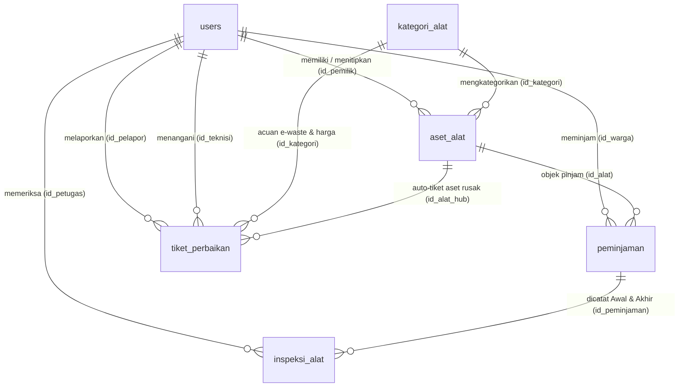
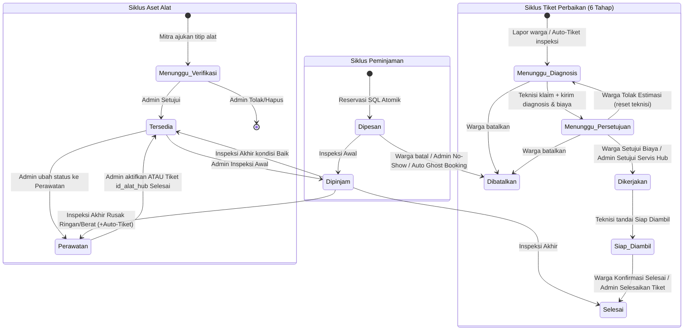
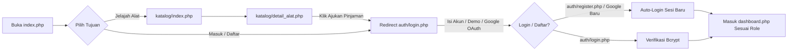
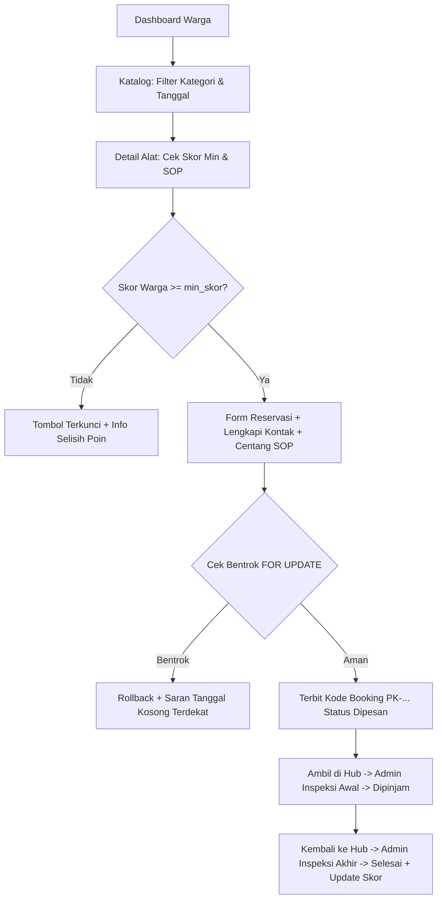
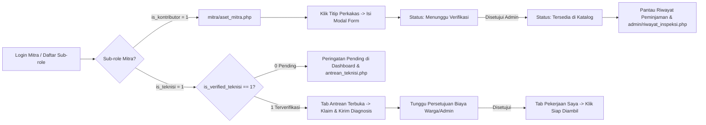
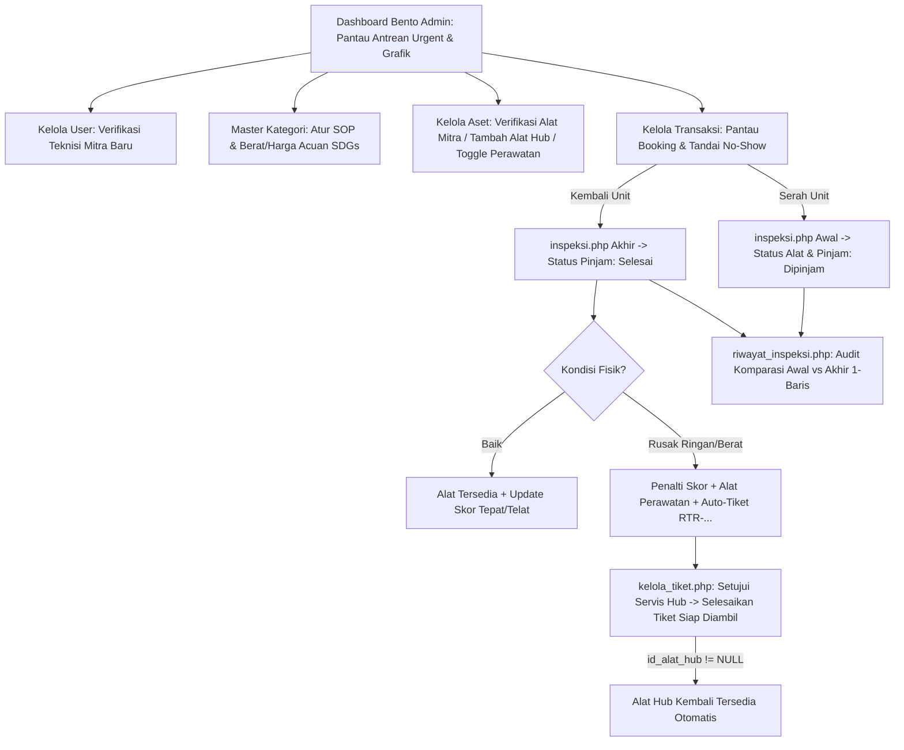

# Dokumentasi Induk & Audit Teknis Menyeluruh: PinjamKarya

> **Status Dokumen:** Hasil audit teknis dan konseptual _end-to-end_ terhadap seluruh isi repository `/pinjamkarya` per **23 November 2026**.  
> **Fungsi Dokumen:** Sumber kebenaran tunggal (_Single Source of Truth_) arsitektur aplikasi dan blueprint naratif-visual pembuatan **Project Showcase** (standar studi kasus **Behance**, publikasi Instagram/LinkedIn, serta pemenuhan elemen wajib **Responsi Praktikum**).

---

## 1. Identitas Aplikasi & Ringkasan Eksekutif

### 1.1 Identitas Proyek

| Atribut                     | Detail Aktual Repository                                                                                                                                               |
| :-------------------------- | :--------------------------------------------------------------------------------------------------------------------------------------------------------------------- |
| **Nama Aplikasi**           | **PinjamKarya** (_Pinjam Karya._)                                                                                                                                      |
| **Konsep Utama**            | Platform Web Ekonomi Sirkular Tingkat Komunitas yang memadukan **Perpustakaan Perkakas (_Library of Things_)** dan **Pusat Perbaikan Mandiri (_Right-to-Repair Hub_)** |
| **Afiliasi Akademik / Hub** | Informatika — Universitas Jenderal Soedirman (sesuai footer `includes/functions.php` & seed Hub Purwokerto Utara)                                                      |
| **Versi & Arsitektur Kode** | PHP Native Modular Berbasis Domain Fitur (`auth/`, `katalog/`, `reservasi/`, `perbaikan/`, `mitra/`, `admin/`)                                                         |
| **Basis Data**              | `pinjamkarya` (MySQL / MariaDB InnoDB — 6 tabel relasional)                                                                                                            |
| **Model Akses**             | Publik (_Landing & Katalog_), Warga/UMKM, Mitra (Kontributor Alat &/atau Teknisi Terverifikasi), Admin Pengelola Hub                                                   |

### 1.2 Deskripsi Menyeluruh

**PinjamKarya** adalah aplikasi web ekonomi sirkular komunitas yang mengintegrasikan dua alur layanan yang saling mengunci dalam satu siklus keberlanjutan:

1. **Perpustakaan Perkakas Komunitas (_Library of Things_):** Memfasilitasi warga dan pelaku UMKM meminjam perkakas pertukangan, peralatan produksi usaha kecil, elektronik rumah tangga, hingga alat bantu kesehatan secara terjadwal. Jaminan peminjaman tidak menggunakan deposit uang tunai yang memberatkan, melainkan **Skor Kepercayaan Komunitas (_Trust Score_)**, kepatuhan **Panduan Keselamatan Kerja (SOP)** per kategori, serta **Inspeksi Fisik Awal dan Akhir** oleh Admin Hub.
2. **Pusat Perbaikan Mandiri (_Right-to-Repair Hub_):** Mempertemukan warga pemilik barang rusak dengan **Mitra Teknisi Lokal Terverifikasi** melalui pelaporan keluhan bergambar, klaim antrean terbuka, diagnosis teknis, penawaran estimasi biaya transparan dengan hak persetujuan atau penolakan penuh di tangan warga, hingga pelacakan progres servis **6 tahap**.

Keterkaitan unik antar kedua ekosistem berjalan secara **siklus tertutup (_closed-loop_)**: apabila sebuah unit perkakas pinjaman dikembalikan warga dalam kondisi `Rusak Ringan` atau `Rusak Berat` saat **Inspeksi Akhir**, sistem secara otomatis mengubah status alat menjadi `Perawatan`, memotong skor kredibilitas peminjam, dan menerbitkan **tiket perbaikan otomatis (`Auto-Tiket Inspeksi`)** bertautan `id_alat_hub`. Setelah teknisi selesai memperbaiki dan Admin menutup tiket tersebut, status unit inventaris otomatis pulih menjadi `Tersedia` di katalog.

### 1.3 Stack Teknologi Lengkap (_Zero Framework & Zero Library_)

Sesuai aturan permanen proyek pada `AGENTS.md` dan implementasi aktual kode:

| Lapisan                      | Teknologi Aktual                                                      | Keterangan Implementasi di Repository                                                                                                                                                                     |
| :--------------------------- | :-------------------------------------------------------------------- | :-------------------------------------------------------------------------------------------------------------------------------------------------------------------------------------------------------- |
| **Backend**                  | **PHP Native 8.2.12** (Prosedural Modular)                            | Tanpa Laravel, CodeIgniter, Symfony, maupun Composer (`vendor/` diabaikan). Seluruh query memakai `mysqli` _Prepared Statements_ + _SQL Transactions_ (`FOR UPDATE`).                                     |
| **Database**                 | **MySQL / MariaDB (InnoDB)**                                          | Charset `utf8mb4` (`utf8mb4_unicode_ci`), integritas referensial _Foreign Key_ (`RESTRICT`, `CASCADE`, `SET NULL`), dan `ENUM` terstruktur.                                                               |
| **Autentikasi Pihak Ketiga** | **Google OAuth 2.0 / OpenID Connect**                                 | Dibangun murni menggunakan ekstensi **PHP cURL** ke endpoint `oauth2.googleapis.com` dan `openidconnect.googleapis.com` tanpa SDK eksternal (`config/google.php`).                                        |
| **Frontend Markup**          | **HTML5 Semantik**                                                    | Landmark `<header>`, `<nav>`, `<main>`, `<section>`, `<article>`, `<aside>`, `<footer>`, `role="dialog"`, `role="progressbar"`, dan _skip-link_ aksesibilitas.                                            |
| **Styling Engine**           | **Vanilla CSS3 Lokal** (`assets/css/pinjamkarya-ui.css`, 4.246 baris) | Memanfaatkan CSS Custom Properties (`:root`), CSS Grid, Flexbox, `clamp()`, `cqi` container sizing, `mask-image` 12-stop, _edge-to-edge sidebar layout_, tanpa Bootstrap/Tailwind/CDN.                    |
| **Tipografi Lokal**          | **Mufaddhol Sans** (`AdwaitaSans-Variable.woff2/.ttf`)                | Variable font lokal (bobot 100–900) berlisensi SIL Open Font License v1.1 (`assets/fonts/OFL.txt`) — nol request Google Fonts.                                                                            |
| **Interaktivitas**           | **Vanilla JS ES6+** (`assets/js/pinjamkarya.js`, 386 baris)           | Drawer navigasi, modal tambah/edit, popup konfirmasi deklaratif `data-confirm`, kalkulator durasi hari real-time, autofill akun demo, _resize-aware masonry layout_, tanpa jQuery/npm.                    |
| **Visual & Grafik**          | **Inline SVG & WebP Lokal**                                           | Seluruh ikon UI (`svg_icon()` di `includes/functions.php`), logo merek, ilustrasi hero (`assets/hero.svg`), serta grafik tren 6 bulan dashboard (`pk_render_svg_trend()`) murni SVG lokal tanpa Chart.js. |
| **Web Server & Proteksi**    | **Apache `.htaccess`**                                                | Penonaktifan _directory indexing_ dan pemblokiran HTTP langsung ke berkas `.sql`, konfigurasi lokal/contoh, dokumentasi internal, serta direktori `config/`, `database/`, dan `includes/`.                |

### 1.4 Struktur Pembagian Peran Tim Pengembang (3 Anggota)

Berdasarkan catatan tim pengembang di `README.md`, identitas akun peran di `database/pinjamkarya.sql`, serta histori kontributor Git (`git shortlog`), tim beranggotakan 3 orang dengan pembagian peran konseptual dan cakupan modul sebagai berikut:

| Anggota    | Peran Tim & Cakupan Sistem                                      | Cakupan Berkas & Modul Utama yang Ditangani                                                                                                                                                                                                     | Catatan Kelengkapan Showcase                                              |
| :--------- | :-------------------------------------------------------------- | :---------------------------------------------------------------------------------------------------------------------------------------------------------------------------------------------------------------------------------------------- | :------------------------------------------------------------------------ |
| **Aflah**  | **Pengelola Hub & Arsitektur Sistem**                           | Arsitektur inti & keamanan (`config/`, `.htaccess`, `database/pinjamkarya.sql`), Autentikasi & Role (`auth/`), Manajemen User, Kategori, Inventaris, Transaksi & Inspeksi Fisik (`admin/`).                                                     | _(Tambahkan NIM, foto profil, dan tautan LinkedIn/GitHub pada slide tim)_ |
| **Balqis** | **Koordinator Mitra Kontributor & Layanan Right-to-Repair**     | Portal Penitipan Alat Mitra (`mitra/aset_mitra.php`), Meja Kerja Teknisi Terverifikasi (`mitra/antrean_teknisi.php`), Tiket Perbaikan Warga (`perbaikan/`), serta integrasi penutupan tiket Hub (`admin/kelola_tiket.php`).                     | _(Tambahkan NIM, foto profil, dan tautan LinkedIn/GitHub pada slide tim)_ |
| **Fadhol** | **Pengembangan Pengalaman Warga, UI/UX & Analitik Dampak SDGs** | Landing Page & Katalog Masonry (`index.php`, `katalog/`), Mesin Reservasi & Kalender (`reservasi/`), Bento Dashboard & Grafik SVG (`dashboard.php`), serta sistem desain terpadu (`assets/css/pinjamkarya-ui.css`, `assets/js/pinjamkarya.js`). | _(Tambahkan NIM, foto profil, dan tautan LinkedIn/GitHub pada slide tim)_ |

---

## 2. Latar Belakang, Permasalahan, Tujuan, Manfaat & Keterkaitan SDGs

### 2.1 Latar Belakang & Permasalahan Nyata di Masyarakat

Di lingkungan permukiman urban maupun semi-urban, kebutuhan akan peralatan kerja dan perawatan rumah tangga berhadapan dengan paradoks kepemilikan:

1. **Investasi Mahal untuk Pemakaian Insidental:** Keluarga muda sering kali hanya membutuhkan bor listrik, gerinda, atau tangga lipat dua meter selama 1–3 hari untuk memasang rak atau memperbaiki atap. Pelaku UMKM rintisan membutuhkan _impulse sealer_ atau _hand mixer_ berkapasitas besar untuk menguji produksi musiman, sementara keluarga yang anggotanya sedang masa pemulihan medis membutuhkan kursi roda atau termometer infrared sementara. Membeli seluruh barang tersebut baru menguras anggaran rumah tangga dan modal UMKM.
2. **Penumpukan Aset Menganggur (_Idle Goods_) vs Ketidakpercayaan Sosial:** Banyak warga atau bengkel rumahan sebenarnya memiliki perkakas layak pakai yang jarang tersentuh di gudang, tetapi enggan meminjamkan kepada tetangga secara informal karena tidak ada pencatatan jadwal, kondisi awal sebelum dipinjam, maupun jaminan kepastian alat kembali tepat waktu dalam keadaan utuh.
3. **Gelombang Sampah Elektronik (_E-Waste_) Akibat Hambatan Servis:** Ketika kipas angin, blender, atau _rice cooker_ mati karena kerusakan ringan (misalnya sekring termal putus atau _thermostat_ aus), warga cenderung langsung membuang barang tersebut. Penyebab utamanya dua hal: sulit menemukan teknisi terverifikasi yang kompeten di sekitar lokasi, dan rasa khawatir terkena "ketok harga" karena biaya tidak dikonsultasikan di muka.

### 2.2 Hambatan Sistem Konvensional Sebelumnya

| Aspek                     | Sistem Konvensional / Grup Chat Warga                                   | Pendekatan Terstruktur di PinjamKarya                                                                       |
| :------------------------ | :---------------------------------------------------------------------- | :---------------------------------------------------------------------------------------------------------- |
| **Pencarian & Jadwal**    | Bertanya manual di grup WhatsApp, rawan jadwal bentrok ganda            | Filter katalog & tanggal real-time + penguncian SQL `FOR UPDATE` + pembersihan _Ghost Booking_ otomatis     |
| **Jaminan Keamanan**      | Uang jaminan (deposit tunai) memberatkan warga berpenghasilan rendah    | **Skor Kepercayaan Komunitas** (modal awal `100` poin, sistem _reward_ `+10` dan penalti terukur)           |
| **Bukti Kondisi Barang**  | Sengketa kerusakan saat pengembalian karena tidak ada berita acara awal | Log **Inspeksi Awal & Akhir** berpasangan per kode booking (`Baik`, `Rusak Ringan`, `Rusak Berat`)          |
| **Keselamatan Pemakaian** | Peminjam awam tidak tahu SOP penggunaan alat berdaya tinggi             | Tampilan **Panduan Keselamatan Kerja** wajib per kategori dan persetujuan eksplisit `setuju_panduan`        |
| **Transparansi Servis**   | Teknisi memperbaiki tanpa persetujuan nominal pasti di awal             | **Alur 6 Tahap**: warga meninjau diagnosis & biaya dulu sebelum berhak klik _Setujui_ atau _Tolak Estimasi_ |

### 2.3 Tujuan & Manfaat Aplikasi

#### Tujuan Spesifik

- Menghadirkan sistem reservasi perkakas dan alat kesehatan komunal yang mencegah bentrok jadwal dan menyaring peminjam berdasarkan rekam jejak kepercayaan (`min_skor`).
- Mengotomasi siklus pemeliharaan aset pinjaman dari pelaporan kerusakan di meja inspeksi hingga selesai diperbaiki teknisi dan kembali aktif di katalog.
- Menyediakan kanal _Right-to-Repair_ yang adil bagi warga pemilik barang dan teknisi lokal terverifikasi.
- Menyajikan transparansi dampak ekonomi dan ekologis komunitas secara _live_ di beranda maupun workspace operasional per peran.

#### Manfaat per Pemangku Kepentingan

- **Bagi Warga & Pelaku UMKM:** Menghemat ratusan ribu hingga jutaan rupiah biaya pembelian perkakas baru (`harga_beli_baru - biaya_perawatan`) dan mendapatkan kepastian biaya sebelum perbaikan barang rusak dijalankan.
- **Bagi Mitra Kontributor Aset:** Menyalurkan nilai guna perkakas pribadi yang menganggur agar produktif bagi masyarakat dengan transparansi log peminjam dan catatan inspeksi kondisi fisik setiap unitnya.
- **Bagi Teknisi Lokal:** Mendapatkan akses antrean pekerjaan terverifikasi tanpa biaya perantara platform komersial, lengkap dengan catatan gejala dan foto kondisi barang sebelum berangkat atau memeriksa unit.
- **Bagi Pengelola Hub & Komunitas:** Mengendalikan mutu keselamatan alat, memisahkan tanggung jawab tiap unit lewat jejak audit inspeksi, serta mendata kontribusi riil pengurangan sampah komunitas.

### 2.4 Pemetaan Eksplisit terhadap Sustainable Development Goals (SDGs)

PinjamKarya selaras langsung dengan tujuan pembangunan berkelanjutan PBB (_Sustainable Development Goals_), terutama dua pilar inti yang didokumentasikan platform dan dua pilar pendukung ekosistemnya:

| Tujuan SDGs                                              | Tingkat Keterkaitan  | Relevansi Permasalahan & Mekanisme Kode di PinjamKarya                                                                                                                                                                                                                                                                                                                   | Dampak Keberlanjutan yang Dihasilkan                                                                                                   |
| :------------------------------------------------------- | :------------------- | :----------------------------------------------------------------------------------------------------------------------------------------------------------------------------------------------------------------------------------------------------------------------------------------------------------------------------------------------------------------------- | :------------------------------------------------------------------------------------------------------------------------------------- |
| **SDG 12: Konsumsi dan Produksi yang Bertanggung Jawab** | **Tujuan Utama**     | Target 12.5 (_mengurangi timbulan limbah melalui pencegahan, pengurangan, daur ulang, dan penggunaan kembali_). Platform menyediakan dua jalur sekaligus: berbagi pakai perkakas (`aset_alat`) dan memperpanjang umur pakai barang elektronik (`tiket_perbaikan`), didukung metrik berat barang `rata_rata_berat_kg` dan `estimasi_harga_baru` di tabel `kategori_alat`. | Menekan konsumsi barang duplikatif di tingkat rumah tangga serta mencegah elektronik rusak berakhir sebagai timbunan _e-waste_ di TPA. |
| **SDG 10: Berkurangnya Kesenjangan**                     | **Tujuan Utama**     | Target 10.2 (_memberdayakan inklusi sosial, ekonomi, dan politik semua orang_). Membuka akses alat pertukangan, mesin UMKM, dan alat bantu medis (seperti kursi roda) tanpa syarat agunan uang atau kartu kredit, cukup menggunakan **Skor Kepercayaan** awal `100` poin yang diberikan gratis saat mendaftar (`auth/register.php` & `auth/google_callback.php`).        | Warga berpenghasilan menengah ke bawah dan UMKM mikro tetap dapat berproduksi dan mengakses alat medis pemulihan secara setara.        |
| **SDG 8: Pekerjaan Layak dan Pertumbuhan Ekonomi**       | **Tujuan Pendukung** | Memfasilitasi pertumbuhan usaha mikro lewat sewa peralatan produksi hemat biaya (_Peralatan Produksi UMKM_) sekaligus membangun kanal kerja profesional bagi tukang/teknisi independen melalui status `is_teknisi` yang dikurasi Admin (`is_verified_teknisi`), dengan rekap nilai jasa di `dashboard.php`.                                                              | Mendorong produktivitas UMKM lokal sekaligus meningkatkan pendapatan dan kredibilitas teknisi perbaikan warga.                         |
| **SDG 11: Kota dan Pemukiman Berkelanjutan**             | **Tujuan Pendukung** | Mengorganisasi infrastruktur mikro tingkat rukun warga / kelurahan berupa titik Hub Komunitas (seed: `Hub Komunitas Purwokerto Utara`) sebagai simpul berbagi logistik, serah-terima aman, dan pemeriksaan fisik alat bersama.                                                                                                                                           | Memperkuat ketahanan sosial komunitas lokal sekaligus mengurangi jejak limbah padat perkotaan.                                         |

---

## 3. Riset Pengguna, Persona & Pemetaan Kebutuhan (Pendekatan Studi Kasus Behance)

Seluruh desain antarmuka, pembatasan fitur, dan skenario uji di PinjamKarya berpusat pada lima karakter pengguna nyata (empat _role/sub-role_ aktif dan variasi tingkat kepercayaan) yang tercermin langsung pada seed data dan hak akses sistem:

### Persona 1 — Fadhol (Warga Aktif & Pelaku UMKM Mikro)

- **Profil:** Usia 29 tahun, pelaku usaha kuliner rumahan dan kepala keluarga di Purwokerto. Status akun: `role = warga`, Skor Kepercayaan tinggi (`110–120` poin).
- **Latar Belakang:** Kadang butuh _impulse sealer_, blender kerja berat, atau mesin bor untuk renovasi lapak dan perbaikan rumah; juga punya barang elektronik dapur (mis. _rice cooker_ / kipas angin) yang sesekali bermasalah.
- **Core Needs:**
  1. Cek alat apa saja yang benar-benar siap pakai pada tanggal tertentu tanpa drama jadwal bentrok.
  2. Bisa memesan cepat dengan panduan keselamatan yang jelas.
  3. Memantau perkembangan servis barang rusaknya dan memutuskan setuju atau menolak biaya servis sebelum dikerjakan.
- **Frustrations:** Kesal jika alat yang diincar mendadak sudah dipinjam orang lain saat hari H, atau bingung menentukan apakah barang rusak di rumah lebih baik diperbaiki atau dibuang.
- **Solusi Fitur di PinjamKarya:** Filter katalog berdasarkan rentang tanggal + badge visual status (`katalog/index.php`), kalender jadwal terisi di halaman detail (`katalog/detail_alat.php`), reservasi bertansaksi atomik (`reservasi/reservasi.php`), dan pelacakan tiket servis 6 tahap lengkap dengan panel keputusan biaya (`perbaikan/tiket_saya.php`).

### Persona 2 — Siti Aminah (Warga dengan Skor Terbatas / Pemula Sistem)

- **Profil:** Usia 37 tahun, ibu rumah tangga. Status akun: `role = warga`, Skor Kepercayaan `65` poin (akibat riwayat keterlambatan/pelanggaran sebelumnya).
- **Latar Belakang:** Membutuhkan alat bantu rumah tangga sederhana atau tangga lipat dan ingin memperbaiki gerinda/elektronik rumah, sekaligus perlu membangun kembali reputasi di komunitas.
- **Core Needs:**
  1. Mengetahui batas skor minimal alat sebelum telanjur mengajukan pinjaman.
  2. Memahami aturan pasti bagaimana cara menaikkan skor kembali (`+10` poin per pengembalian tepat waktu & baik).
  3. Tetap dapat melaporkan kerusakan barang rumah tangga meski skor pinjamnya sedang rendah.
- **Frustrations:** Merasa terhukum secara membabi buta jika tiba-tiba ditolak tanpa penjelasan selisih poin dan alasan penalti pada inspeksi sebelumnya.
- **Solusi Fitur di PinjamKarya:** Kartu status `Skor Terbatas` dan meter akses katalog di `dashboard.php`, kartu rincian aturan `+10 / -5 / -15` serta tabel **Riwayat Inspeksi** transparan di `auth/profil.php`, penahanan tombol submit otomatis bila `skor_warga < min_skor` dengan keterangan selisih poin jelas di `reservasi.php`, namun layanan perbaikan `buat_tiket.php` tetap terbuka penuh.

### Persona 3 — Balqis (Mitra Kontributor Alat & Teknisi Terverifikasi)

- **Profil:** Usia 34 tahun, pemilik bengkel kecil sekaligus penghobi peralatan teknik. Status akun: `role = mitra` dengan sub-peran ganda `is_kontributor = 1`, `is_teknisi = 1`, `is_verified_teknisi = 1`.
- **Latar Belakang:** Memiliki unit perkakas berkualitas (seperti bor listrik Bosch, _impulse sealer_, _hand mixer_) yang jarang dipakai harian, dan punya keahlian memperbaiki barang elektronik rumah tangga.
- **Core Needs:**
  1. Menitipkan unit perkakas miliknya agar dimanfaatkan warga tanpa kehilangan kontrol atas kondisi fisik alatnya.
  2. Melihat daftar warga pelapor kerusakan beserta gejala & foto untuk mengambil pekerjaan servis sesuai keahlian.
  3. Mengelola semua pekerjaan aktif dan penitipan dalam satu ruang kerja terpadu.
- **Frustrations:** Khawatir alat titipannya dipinjam orang yang ceroboh dan tidak tahu hasil pemeriksaannya; di sisi teknisi, repot jika warga mendadak membatalkan perbaikan setelah komponen terlanjur dibeli tanpa persetujuan biaya sebelumnya.
- **Solusi Fitur di PinjamKarya:** Formulir pengajuan penitipan aset (`mitra/aset_mitra.php`) dengan pengaturan `min_skor` oleh pemilik, akses khusus melihat `admin/riwayat_inspeksi.php` khusus untuk alat miliknya, serta **Meja Kerja Teknisi** (`mitra/antrean_teknisi.php`) dua tab (`Antrean Terbuka` & `Pekerjaan Saya`) yang memblokir pengerjaan hingga `persetujuan_warga = 1`.

### Persona 4 — Budi Santoso (Mitra Teknisi Baru / _Pending Verification_)

- **Profil:** Usia 26 tahun, teknisi elektronika mandiri yang baru mendaftar sebagai `mitra` dengan `is_teknisi = 1` dan `is_verified_teknisi = 0`.
- **Latar Belakang:** Ingin ikut membantu komunitas Hub memperbaiki barang elektronik warga.
- **Core Needs:** Mengetahui dengan jelas apakah akun teknisinya sudah disetujui Admin Hub atau masih dalam antrean peninjauan.
- **Frustrations:** Kebingungan saat melihat tombol menu yang error tanpa kejelasan mengapa belum bisa mengklaim pekerjaan servis.
- **Solusi Fitur di PinjamKarya:** Badge `Pending` di sidebar dan status KPI `Teknisi Pending` di `dashboard.php`, serta halaman informasi terpandu `Menunggu Verifikasi Admin Hub` di `mitra/antrean_teknisi.php` (serta pemblokiran aksi `POST` klaim di level backend sebelum `is_verified_teknisi = 1`).

### Persona 5 — Aflah (Admin Pengelola Hub Komunitas)

- **Profil:** Usia 23 tahun, koordinator operasional Hub Komunitas Purwokerto Utara. Status akun: `role = admin`.
- **Latar Belakang:** Bertanggung jawab memastikan seluruh aset aman, teknisi kompeten, transaksi peminjaman tertib, dan barang inventaris Hub yang rusak segera masuk ke antrean servis.
- **Core Needs:**
  1. Mengetahui item mendesak hari ini dalam sekali lihat (alat mitra menunggu verifikasi, teknisi baru menunggu verifikasi, pesanan menunggu serah-terima).
  2. Mencatat kondisi fisik Awal vs Akhir secara cepat sekaligus melihat perbandingan perubahannya dalam satu tampilan tabel ringkas.
  3. Menghindari kesalahan klik fatal (seperti menghapus unit alat atau memaksa status ke `Perawatan`) tanpa konfirmasi sadar.
- **Frustrations:** Bingung ketika log inspeksi Awal dan Akhir terpencar di dua baris berbeda, serta kerepotan membuat tiket servis manual setiap kali alat Hub kembali rusak.
- **Solusi Fitur di PinjamKarya:** Bento Dashboard Admin yang memusatkan metrik mendesak (`urgent_count`), _Auto-Tiket Inspeksi_ otomatis saat kondisi Akhir rusak (`admin/inspeksi.php`), tabel perbandingan inspeksi **1 booking = 1 baris** (`admin/riwayat_inspeksi.php`), pemulihan otomatis aset Hub di `admin/kelola_tiket.php`, serta popup konfirmasi kustom (`#pkConfirmModal`) pada seluruh aksi status dan penghapusan.

---

## 4. Arsitektur Sistem, Peta Direktori & Kamus Database Lengkap

### 4.1 Peta Direktori & Inventaris Seluruh Berkas Repository

Berikut seluruh folder dan berkas aktual yang diaudit di dalam `/opt/lampp/htdocs/pinjamkarya`:

```text
pinjamkarya/
├── .htaccess                           # Deny directory listing + blokir akses HTTP ke .sql, .local.php, .example.php, AGENTS.md, README.md
├── .gitignore                          # Mengecualikan config/*.local.php, media unggahan runtime, .env, skills/, log/editor
├── AGENTS.md                           # (Tercatat di HEAD git & aturan .htaccess; berstatus deleted pada working tree saat audit) Pedoman stack 100% PHP Native, Vanilla CSS3, Vanilla JS
├── README.md                           # Dokumentasi awal proyek (catatan: struktur folder di README masih merujuk skema lama modul1-9)
├── explain.md                          # [Dokumen ini] Panduan induk audit teknis, arsitektur, dan blueprint showcase Behance
├── index.php                           # Landing Page publik + live metrik SDGs + layanan utama + pratinjau 4 alat masonry
├── dashboard.php                       # Workspace Bento Grid operasional dinamis per role (Admin, Mitra 3 varian, Warga)
│
├── config/
│   ├── .htaccess                       # Blokir penuh seluruh akses HTTP ke folder config/
│   ├── app.php                         # Bootstrapper inti: deteksi BASE_URL, config layering, cookie session, timezone, upload path, autoload
│   ├── config.example.php              # Templat konfigurasi terpusat (app, database, google OAuth) untuk disalin ke config.local.php
│   ├── database.php                    # Koneksi mysqli dengan error reporting ketat & charset utf8mb4
│   ├── google.php                      # Helper Google OAuth 2.0 & OpenID Connect murni PHP cURL
│   ├── google.example.php              # Templat legacy khusus Google OAuth
│   └── google.local.php                # Kredensial Google OAuth lokal (diabaikan git; saat ini kosong / nonaktif secara default)
│
├── database/
│   ├── .htaccess                       # Blokir penuh seluruh akses HTTP ke folder database/
│   └── pinjamkarya.sql                 # DDL 6 tabel relasional InnoDB + seed data 5 user, 4 kategori, 5 aset, 3 pinjam, 2 inspeksi, 3 tiket
│
├── includes/
│   ├── .htaccess                       # Blokir penuh seluruh akses HTTP ke folder includes/
│   ├── functions.php                   # 22 fungsi utilitas: sanitasi, format, role/badge, flash/modal feedback, guard auth, jadwal, upload, SVG icon, navbar/footer publik, tool card
│   ├── header.php                      # Pembuka HTML + switcher 3 mode layout ($minimal_layout, $public_layout, App Shell + Navbar)
│   ├── sidebar.php                     # Panel navigasi sidebar edge-to-edge dinamis per role & sub-role + card profil + Ke Landing Page + Keluar
│   └── footer.php                      # Penutup layout + popup konfirmasi global #pkConfirmModal + pemuat deferred pinjamkarya.js
│
├── auth/
│   ├── login.php                       # Login email+password, pengisi cepat 5 akun demo, dan tombol Login Google
│   ├── register.php                    # Registrasi Warga / Mitra (Kontributor &/atau Teknisi) dengan auto-login langsung ke dashboard
│   ├── logout.php                      # Penghapusan total sesi + cookie sesi + redirect ke login
│   ├── profil.php                      # Edit data diri/kontak/password, kartu Skor Kepercayaan/Status Mitra, dan Riwayat Inspeksi warga
│   ├── google_login.php                # Pembangkit CSRF state OAuth + pengarah ke Google Consent Screen
│   └── google_callback.php             # Penerima callback OAuth, verifikasi state & email, auto-register user warga baru + auto-login
│
├── katalog/
│   ├── index.php                       # Katalog semua alat (filter kategori, cari keyword, filter jadwal bebas bentrok; adaptif publik vs dashboard)
│   └── detail_alat.php                 # Spesifikasi alat, status ketersediaan, Panduan Keselamatan SOP, dan jadwal terisi alat
│
├── reservasi/
│   ├── reservasi.php                   # Form reservasi warga + gate Skor Kepercayaan + SOP wajib + SQL transaction FOR UPDATE
│   └── riwayat_pinjam.php              # Daftar kartu pinjaman warga, hasil inspeksi awal/akhir, dan pembatalan pesanan Dipesan
│
├── perbaikan/
│   ├── buat_tiket.php                  # Formulir pengajuan perbaikan barang warga + pilihan metode cek + unggah foto kerusakan
│   └── tiket_saya.php                  # Pelacak progres servis 6 tahap, persetujuan/penolakan estimasi biaya, batal, & konfirmasi selesai
│
├── mitra/
│   ├── aset_mitra.php                  # Daftar alat titipan mitra kontributor, riwayat sewa alatnya, & modal form ajukan titip alat baru
│   └── antrean_teknisi.php             # Guard teknisi terverifikasi + Tab Antrean Terbuka (klaim & diagnosis) + Tab Pekerjaan Saya (Siap Diambil)
│
├── admin/
│   ├── kelola_user.php                 # Daftar semua user per role + tombol verifikasi / cabut status teknisi mitra
│   ├── kelola_kategori.php             # CRUD master kategori, panduan keselamatan, rata-rata berat (Kg), dan estimasi harga baru
│   ├── kelola_aset.php                 # Antrean verifikasi alat titipan mitra + CRUD inventaris Hub + toggle Perawatan + foto fade
│   ├── kelola_transaksi.php            # Pemantauan seluruh peminjaman + filter status + link Inspeksi Awal/Akhir + pembatalan No-Show
│   ├── inspeksi.php                    # Form pencatatan Inspeksi Awal (serah) & Akhir (kembali) + kalkulasi skor & Auto-Tiket kerusakan
│   ├── riwayat_inspeksi.php            # Log inspeksi 1 baris per booking (komparasi side-by-side Awal -> Akhir); juga dapat diakses Mitra Kontributor
│   └── kelola_tiket.php                # Pemantauan semua tiket perbaikan + persetujuan servis Aset Hub + penutupan tiket & pemulihan status aset
│
├── assets/
│   ├── favicon.svg                     # Ikon kotak perkakas vektor (#2e2d2a -> #1f1f1d)
│   ├── hero.svg                        # Ilustrasi perkakas bertakik (notched frame 583x348) untuk Hero Landing Page
│   ├── perkakas.webp                   # Media latar kartu layanan "Pinjam Perkakas & Alat Kesehatan" (1200x800)
│   ├── service.webp                    # Media latar kartu layanan "Perbaiki Barang Rusak" (1200x800)
│   ├── hasil.webp                      # Aset gambar statis tambahan di folder assets/ (tidak direferensikan di halaman PHP aktif)
│   ├── img/.gitkeep                    # Direktori opsional untuk hero-image / hero-banner (lookup get_hero_banner())
│   ├── css/pinjamkarya-ui.css          # Stylesheet tunggal aplikasi (4.246 baris: token desain, layout, komponen, tabel, modal, responsif)
│   ├── js/pinjamkarya.js               # Script tunggal ES6+ (386 baris: navigasi, modal, popup konfirmasi, tab, demo login, durasi, masonry)
│   ├── fonts/
│   │   ├── AdwaitaSans-Variable.woff2  # Font variabel primer yang di-preload di header
│   │   ├── AdwaitaSans-Variable.ttf    # Fallback TrueType font lokal
│   │   └── OFL.txt                     # Lisensi SIL Open Font License 1.1
│   └── uploads/
│       ├── alat/.gitkeep (+ 20 .webp)  # Foto unit perkakas (unggah runtime berawalan alat_ / mitra_ + 20 foto katalog lokal)
│       └── tiket/.gitkeep (+ 1 .png)   # Foto bukti kerusakan barang dari warga / auto-tiket (berawalan tiket_)
│
└── skills/
    └── antislop.md                     # Panduan penulisan adaptif berbahasa Indonesia (dikecualikan oleh .gitignore)
```

> **Catatan Audit Dokumentasi vs Kode Aktual:** Berkas `README.md` masih mencantumkan struktur folder prototipe lama (`modul1/`..`modul9/`, `panduan.php`, dan nama database `db_pinjamkarya`). Pada repository berjalan saat ini, sistem telah **direfaktor menyeluruh** ke arsitektur domain (`auth/`, `katalog/`, `reservasi/`, `perbaikan/`, `mitra/`, `admin/`) dengan database `pinjamkarya`, halaman panduan dilebur ke `katalog/detail_alat.php` & `reservasi/reservasi.php`, ditambah Google OAuth 2.0, auto-login registrasi, dashboard Bento Grid multi-role (`dashboard.php`), dan popup konfirmasi UI kustom (`#pkConfirmModal`).

### 4.2 Arsitektur Sistem, Konfigurasi & Mekanisme Request-Response

1. **Bootstrapping Terpusat (`config/app.php`):**
   Setiap skrip PHP halaman memuat `config/app.php` pada baris pertama. Urutan kerjanya:
   - Menentukan `ROOT_PATH` dan membaca konfigurasi melalui `pk_config()` dengan tiga tingkat prioritas penimpaan (_layering_): **Default internal** (`host: localhost`, `port: 3306`, `name: pinjamkarya`, `timezone: Asia/Jakarta`, `debug: false`) $\rightarrow$ berkas lokal `config/config.local.php` $\rightarrow$ fallback legacy `config/google.local.php` $\rightarrow$ _environment variables_ (`APP_BASE_URL`, `DB_HOST`, `DB_NAME`, `GOOGLE_CLIENT_ID`, dst.).
   - Mendeteksi `BASE_URL` secara dinamis lewat `pk_detect_base_url()` berdasarkan `DOCUMENT_ROOT` dan `ROOT_PATH`, sehingga aplikasi tetap berjalan mulus baik di `http://localhost/pinjamkarya` maupun di root domain produksi tanpa edit manual.
   - Memulai sesi PHP dengan parameter cookie aman: `httponly: true`, `samesite: 'Lax'`, `lifetime: 0`, dan `secure` otomatis saat protokol HTTPS terdeteksi (`pk_is_https()`).
   - Memuat berurutan `config/database.php`, `config/google.php`, dan `includes/functions.php`.

2. **Tiga Mode Tata Letak Adaptif (`includes/header.php` & `includes/footer.php`):**
   - **Minimal Layout (`$minimal_layout = true`):** Dipakai oleh `auth/login.php` dan `auth/register.php`. Merender `<main class="pk-auth-main">` terpusat tanpa navbar atau sidebar, serta tidak merender `#pkConfirmModal`.
   - **Public Layout (`$public_layout = true`):** Dipakai di `katalog/index.php` dan `katalog/detail_alat.php` **hanya ketika pengunjung belum login** (`!isset($_SESSION['user'])`). Menampilkan floating glass navigation bar `render_public_nav()` dan `render_public_footer()`. Begitu pengguna sudah masuk, variabel `$public_layout` otomatis bernilai `false`, sehingga navigasi Katalog tetap berada di dalam **Workspace Dashboard** (`pk-app-shell`) tanpa melempar pengguna keluar dari konteks dasbor.
   - **Dashboard App Shell (default ketika login atau halaman internal):** Merender tata letak dua kolom _full-bleed_ (`grid-template-columns: 252px minmax(0, 1fr)` di desktop `>= 992px`), dengan sidebar menempel penuh (_edge-to-edge sticky full-height_) di kiri dan topbar responsif hanya muncul pada viewport `< 992px`.

3. **Alur Request–Response & Preservasi Error Modal:**
   - Seluruh aksi mutasi memakai pola **Post–Redirect–Get (PRG)** dengan pesan status disimpan di `$_SESSION['flash']` lewat `set_flash()` dan dirender aman oleh `render_alert()`.
   - Khusus form modal (`admin/kelola_kategori.php` dan `admin/kelola_aset.php`), kesalahan input disimpan sementara ke `$_SESSION['modal_feedback']` bersama array `$old` (`set_modal_feedback()`), lalu redirect menuju `?open=form` atau `?edit={id}` agar modal terbuka ulang otomatis lengkap dengan nilai ketikan pengguna sebelumnya (_state preservation_).

### 4.3 Audit Keamanan & Integritas Data

#### Kontrol Keamanan yang Sudah Diterapkan

- **Anti-SQL Injection:** Seluruh query yang menerima input eksternal atau parameter ID/filter menggunakan `mysqli_prepare` dan `mysqli_stmt_bind_param` (termasuk helper `pk_stmt_all()` dan `pk_stmt_one()` di `dashboard.php`).
- **Anti-XSS Output Encoding:** Seluruh output teks dari database maupun input pengguna dibungkus fungsi `e()` (`htmlspecialchars((string)$string, ENT_QUOTES, 'UTF-8')`).
- **Hashing & Session Hygiene:** Kata sandi di-hash menggunakan `password_hash($password, PASSWORD_DEFAULT)` (`bcrypt`) dan diverifikasi lewat `password_verify()`. Kolom `password` dihapus dari array sesi (`unset($user['password'])`), dan `refresh_user_session($conn)` di `header.php` selalu menyinkronkan peran, flag teknisi, serta skor terbaru dari database di setiap halaman sehingga perubahan skor/pencabutan teknisi langsung berefek seketika.
- **Kontrol Akses Berbasis Role & Sub-Role (_RBAC + Attribute Check_):** Fungsi `require_login()`, `require_role(['admin'|'mitra'|'warga'])`, serta verifikasi atribut eksplisit di backend seperti pengecekan `is_kontributor` (`mitra/aset_mitra.php`), `is_teknisi` + `is_verified_teknisi` (`mitra/antrean_teknisi.php`), dan kepemilikan baris pada query SQL (`WHERE id_peminjaman = ? AND id_warga = ?` atau `WHERE id_tiket = ? AND id_pelapor = ?`).
- **Konsistensi Transaksi & Anti-Race Condition:** `reservasi.php`, `inspeksi.php`, dan `kelola_tiket.php` menggunakan `mysqli_begin_transaction()` + `SELECT ... FOR UPDATE` untuk mengunci baris aset atau tiket sebelum melakukan perubahan kondisi atau penambahan jadwal. `antrean_teknisi.php` memakai klaim kondisional atomik `WHERE id_tiket = ? AND id_teknisi IS NULL AND status_tiket = 'Menunggu Diagnosis'`.
- **Validasi Unggahan Gambar (`upload_gambar()`):** Mengecek `UPLOAD_ERR_OK`, batas ukuran `2 MB` (`2 * 1024 * 1024`), whitelist ekstensi `jpg`, `jpeg`, `png`, `webp`, validasi header citra asli dengan `@getimagesize($file['tmp_name'])`, dan penamaan ulang unik berbasis `time()` + `bin2hex(random_bytes(4))`.
- **Proteksi Direktori & OAuth State:** Berkas `.htaccess` di root, `config/`, `database/`, dan `includes/` memblokir akses HTTP ke skrip konfigurasi dan `.sql`. Login Google dilindungi parameter `state` acak `bin2hex(random_bytes(24))` yang dicocokkan dengan `hash_equals()`, serta menolak akun Google yang `email_verified`-nya bernilai false.

#### Temuan Audit Teknis Jujur (_Hardening Notes_ untuk Pengembangan Lanjutan)

Audit langsung terhadap seluruh skrip menemukan beberapa celah kecil yang jujur dicatat:

1. **Belum Ada Token Anti-CSRF Per-Form:** Formulir `POST` aplikasi mengandalkan proteksi `SameSite=Lax` pada cookie sesi, belum dilengkapi _hidden input CSRF token_ per-sesi.
2. **Regenerasi ID Sesi pada Login Manual:** `session_regenerate_id(true)` sudah diterapkan pada `auth/register.php` dan `auth/google_callback.php`, namun belum dipanggil setelah `password_verify()` berhasil di `auth/login.php`.
3. **Hardening Folder Unggahan:** Direktori `assets/uploads/` belum memiliki berkas `.htaccess` lokal (seperti penonaktifan eksekutor skrip PHP di folder upload) sebagai lapisan pertahanan ganda selain validasi `upload_gambar()`.
4. **Inkonsistensi Kecil Antar Berkas:**
   - Rumus penghematan di `index.php` (`SUM(a.harga_beli_baru - a.biaya_perawatan)`) belum memakai `GREATEST(..., 0)` sebagaimana `dashboard.php` (`GREATEST(k.estimasi_harga_baru - t.estimasi_biaya, 0)`).
   - Pada `perbaikan/tiket_saya.php`, tombol aksi `approve_cost` (_Setujui Biaya_) melakukan `POST` langsung tanpa atribut `data-confirm` konfirmasi UI, berbeda dengan `reject_cost`, `cancel_ticket`, dan `confirm_done` di halaman yang sama.
   - Di `katalog/detail_alat.php`, query jadwal terisi mengambil `u.nama AS nama_peminjam`, namun tampilan tabel publik hanya merender kode booking, tanggal mulai–selesai, dan status (privasi peminjam tetap terjaga pada output HTML).

### 4.4 Kamus Skema Database Lengkap (`pinjamkarya`)

Basis data `pinjamkarya` dibangun di atas engine **InnoDB** dengan **6 tabel relasional**. Pemeriksaan terhadap database aktif saat audit juga mencatat kapasitas data uji berjalan saat ini: `8` baris di `users`, `4` baris di `kategori_alat`, `20` baris di `aset_alat`, `4` baris di `peminjaman`, `4` baris di `inspeksi_alat`, dan `4` baris di `tiket_perbaikan`.

#### 1. Tabel `users` (Autentikasi, Peran Ganda Mitra & Skor Kredibilitas)

| Kolom                 | Tipe Data & Batasan                             | Fungsi & Aturan Bisnis                                                                                      |
| :-------------------- | :---------------------------------------------- | :---------------------------------------------------------------------------------------------------------- |
| `id_user`             | `INT AUTO_INCREMENT PK`                         | Identitas unik pengguna                                                                                     |
| `nama`                | `VARCHAR(100) NOT NULL`                         | Nama lengkap atau identitas akun; diringkas di UI via `format_nama_pengguna()`                              |
| `email`               | `VARCHAR(100) NOT NULL UNIQUE`                  | Kunci login unik dan pencocokan Google OAuth                                                                |
| `password`            | `VARCHAR(255) NOT NULL`                         | Hash bcrypt (akun Google OAuth diisi hash acak 48 hex char)                                                 |
| `no_hp`               | `VARCHAR(20) NOT NULL`                          | Nomor WhatsApp/kontak (diisi `'-'` jika via Google baru, dilengkapi lewat lazy contact check)               |
| `alamat`              | `TEXT NOT NULL`                                 | Alamat domisili/hub (diisi `'-'` saat daftar cepat/OAuth, dilengkapi sebelum pinjam/servis/titip)           |
| `role`                | `ENUM('admin','mitra','warga') DEFAULT 'warga'` | Hak akses level utama                                                                                       |
| `is_kontributor`      | `TINYINT(1) DEFAULT 0`                          | Flag sub-peran Mitra sebagai penitip unit perkakas                                                          |
| `is_teknisi`          | `TINYINT(1) DEFAULT 0`                          | Flag sub-peran Mitra sebagai calon/pelaku teknisi servis                                                    |
| `is_verified_teknisi` | `TINYINT(1) DEFAULT 0`                          | Gerbang verifikasi Admin agar mitra teknisi dapat mengklaim tiket servis                                    |
| `skor_kredibilitas`   | `INT DEFAULT 100`                               | Modal awal `100` poin untuk kelayakan pinjam (`min_skor`); bertambah `+10` atau berkurang `-5/hari` / `-15` |
| `created_at`          | `TIMESTAMP DEFAULT CURRENT_TIMESTAMP`           | Tanggal bergabung                                                                                           |

#### 2. Tabel `kategori_alat` (Master Kategori, SOP Keselamatan & Parameter Dampak SDGs)

| Kolom                 | Tipe Data & Batasan          | Fungsi & Aturan Bisnis                                                                                                    |
| :-------------------- | :--------------------------- | :------------------------------------------------------------------------------------------------------------------------ |
| `id_kategori`         | `INT AUTO_INCREMENT PK`      | Identitas unik kategori                                                                                                   |
| `nama_kategori`       | `VARCHAR(100) NOT NULL`      | Label kategori (_Pertukangan & Konstruksi_, _Peralatan Produksi UMKM_, _Alat Bantu Kesehatan_, _Elektronik Rumah Tangga_) |
| `panduan_keselamatan` | `TEXT NOT NULL`              | Teks prosedur SOP keselamatan yang wajib ditampilkan di detail alat & disetujui warga saat reservasi                      |
| `rata_rata_berat_kg`  | `DECIMAL(6,2) DEFAULT 1.00`  | Parameter acuan bobot pengurangan potensi _e-waste_ (Kg)                                                                  |
| `estimasi_harga_baru` | `DECIMAL(12,2) DEFAULT 0.00` | Acuan harga beli baru untuk menghitung nilai penghematan warga pada modul layanan servis `tiket_perbaikan`                |

#### 3. Tabel `aset_alat` (Inventaris Unit Fisik Hub & Titipan Mitra)

| Kolom             | Tipe Data & Batasan                                                                           | Fungsi & Aturan Bisnis                                                                                              |
| :---------------- | :-------------------------------------------------------------------------------------------- | :------------------------------------------------------------------------------------------------------------------ |
| `id_alat`         | `INT AUTO_INCREMENT PK`                                                                       | Identitas unik unit perkakas                                                                                        |
| `id_kategori`     | `INT NOT NULL FK -> kategori_alat`                                                            | `ON DELETE RESTRICT` (kategori tidak boleh terhapus jika masih punya unit)                                          |
| `id_pemilik`      | `INT NOT NULL FK -> users`                                                                    | `ON DELETE CASCADE`; jika pemilik `admin` dianggap **Inventaris Hub**, jika `mitra` dianggap **Alat Titipan Mitra** |
| `nama_alat`       | `VARCHAR(150) NOT NULL`                                                                       | Nama & merek alat fisik                                                                                             |
| `deskripsi`       | `TEXT NOT NULL`                                                                               | Spesifikasi teknis dan kelengkapan aksesoris unit                                                                   |
| `foto_alat`       | `VARCHAR(255) DEFAULT 'default_alat.jpg'`                                                     | Nama file di `assets/uploads/alat/` (jika `'default_alat.jpg'` atau file hilang, dirender placeholder SVG)          |
| `harga_beli_baru` | `DECIMAL(12,2) DEFAULT 0.00`                                                                  | Nilai beli unit baru untuk kalkulasi penghematan peminjaman (`harga_beli_baru - biaya_perawatan`)                   |
| `biaya_perawatan` | `DECIMAL(12,2) DEFAULT 0.00`                                                                  | Biaya kontribusi rawat (`0` ditampilkan sebagai `Gratis`)                                                           |
| `max_hari_pinjam` | `INT DEFAULT 3`                                                                               | Batas maksimum lama pinjam dalam hari                                                                               |
| `min_skor`        | `INT DEFAULT 50`                                                                              | Ambang batas minimal `skor_kredibilitas` peminjam                                                                   |
| `status_alat`     | `ENUM('Menunggu Verifikasi','Tersedia','Dipinjam','Perawatan') DEFAULT 'Menunggu Verifikasi'` | Status fisik unit saat ini; `Menunggu Verifikasi` dipakai pengajuan baru Mitra                                      |
| `created_at`      | `TIMESTAMP DEFAULT CURRENT_TIMESTAMP`                                                         | Waktu pencatatan unit                                                                                               |

#### 4. Tabel `peminjaman` (Reservasi Jadwal & Transaksi)

| Kolom               | Tipe Data & Batasan                                                   | Fungsi & Aturan Bisnis                                |
| :------------------ | :-------------------------------------------------------------------- | :---------------------------------------------------- |
| `id_peminjaman`     | `INT AUTO_INCREMENT PK`                                               | Identitas transaksi peminjaman                        |
| `kode_booking`      | `VARCHAR(30) NOT NULL UNIQUE`                                         | Format `PK-YYYYMMDD-NNN`                              |
| `id_alat`           | `INT NOT NULL FK -> aset_alat`                                        | `ON DELETE RESTRICT`                                  |
| `id_warga`          | `INT NOT NULL FK -> users`                                            | `ON DELETE CASCADE`                                   |
| `tgl_mulai`         | `DATE NOT NULL`                                                       | Tanggal ambil unit                                    |
| `tgl_selesai`       | `DATE NOT NULL`                                                       | Batas akhir pengembalian (acuan hitung `$hari_telat`) |
| `setuju_panduan`    | `TINYINT(1) DEFAULT 1`                                                | Persetujuan SOP keselamatan oleh warga                |
| `status_peminjaman` | `ENUM('Dipesan','Dipinjam','Selesai','Dibatalkan') DEFAULT 'Dipesan'` | Siklus hidup booking                                  |
| `created_at`        | `TIMESTAMP DEFAULT CURRENT_TIMESTAMP`                                 | Dipakai untuk tren aktivitas bulanan & urutan antrean |

#### 5. Tabel `inspeksi_alat` (Log Audit Kondisi Fisik Awal & Akhir)

| Kolom              | Tipe Data & Batasan                                  | Fungsi & Aturan Bisnis                                               |
| :----------------- | :--------------------------------------------------- | :------------------------------------------------------------------- |
| `id_inspeksi`      | `INT AUTO_INCREMENT PK`                              | Identitas berita acara pemeriksaan                                   |
| `id_peminjaman`    | `INT NOT NULL FK -> peminjaman`                      | `ON DELETE CASCADE`                                                  |
| `id_petugas`       | `INT NOT NULL FK -> users`                           | `ON DELETE RESTRICT` (Admin Hub pemeriksa fisik)                     |
| `jenis_inspeksi`   | `ENUM('Awal','Akhir') NOT NULL`                      | Tahap saat serah keluar (`Awal`) dan saat kembali (`Akhir`)          |
| `kondisi_fisik`    | `ENUM('Baik','Rusak Ringan','Rusak Berat') NOT NULL` | Hasil pemeriksaan; jika Akhir != `Baik`, memicu penalti & auto-tiket |
| `catatan_inspeksi` | `TEXT NOT NULL`                                      | Deskripsi kelengkapan/keadaan kabel/mesin                            |
| `waktu_inspeksi`   | `TIMESTAMP DEFAULT CURRENT_TIMESTAMP`                | Stempel waktu pemeriksaan                                            |

#### 6. Tabel `tiket_perbaikan` (Meja Right-to-Repair & Servis Aset Hub)

| Kolom                 | Tipe Data & Batasan                                                                                                                 | Fungsi & Aturan Bisnis                                                                    |
| :-------------------- | :---------------------------------------------------------------------------------------------------------------------------------- | :---------------------------------------------------------------------------------------- |
| `id_tiket`            | `INT AUTO_INCREMENT PK`                                                                                                             | Identitas tiket perbaikan                                                                 |
| `kode_tiket`          | `VARCHAR(30) NOT NULL UNIQUE`                                                                                                       | Format `RTR-YYYYMMDD-NNN`                                                                 |
| `id_pelapor`          | `INT NOT NULL FK -> users`                                                                                                          | `ON DELETE CASCADE` (Warga atau Admin Hub pembuat auto-tiket)                             |
| `id_kategori`         | `INT NOT NULL FK -> kategori_alat`                                                                                                  | `ON DELETE RESTRICT`                                                                      |
| `id_teknisi`          | `INT NULL FK -> users`                                                                                                              | `ON DELETE SET NULL`; diisi ketika teknisi terverifikasi mengklaim tiket                  |
| `id_alat_hub`         | `INT NULL FK -> aset_alat`                                                                                                          | `ON DELETE SET NULL`; terisi khusus apabila tiket berasal dari kerusakan unit katalog Hub |
| `nama_barang`         | `VARCHAR(150) NOT NULL`                                                                                                             | Nama & merek barang yang diperbaiki                                                       |
| `deskripsi_kerusakan` | `TEXT NOT NULL`                                                                                                                     | Keluhan awal (auto-tiket diawali `[Auto-Tiket Inspeksi]`)                                 |
| `foto_barang`         | `VARCHAR(255) DEFAULT 'default_tiket.jpg'`                                                                                          | Foto barang di `assets/uploads/tiket/`                                                    |
| `metode_cek`          | `ENUM('Diantar ke Hub','Kunjungan Teknisi') DEFAULT 'Diantar ke Hub'`                                                               | Pilihan mekanisme pengecekan fisik                                                        |
| `diagnosis_teknisi`   | `TEXT NULL`                                                                                                                         | Temuan kerusakan dan rencana perbaikan dari teknisi                                       |
| `estimasi_biaya`      | `DECIMAL(12,2) DEFAULT 0.00`                                                                                                        | Penawaran biaya jasa/suku cadang                                                          |
| `estimasi_hari`       | `INT DEFAULT 0`                                                                                                                     | Estimasi durasi pengerjaan                                                                |
| `persetujuan_warga`   | `TINYINT(1) DEFAULT 0`                                                                                                              | `1` jika disetujui warga (atau Admin Hub untuk tiket aset Hub)                            |
| `status_tiket`        | `ENUM('Menunggu Diagnosis','Menunggu Persetujuan','Dikerjakan','Siap Diambil','Selesai','Dibatalkan') DEFAULT 'Menunggu Diagnosis'` | Status pelacakan 6 tahap                                                                  |
| `created_at`          | `TIMESTAMP DEFAULT CURRENT_TIMESTAMP`                                                                                               | Waktu pelaporan tiket                                                                     |

#### Diagram Relasi Antar-Tabel (Mermaid ERD)



#### Siklus Perubahan Status (_State Lifecycle_) Lintas Entitas



---

## 5. Bedah Mendalam Seluruh Modul & Logika Bisnis (9 Modul Terintegrasi)

Pemetaan 9 modul fungsional proyek sesuai kode repository aktual:

### Modul 1: Autentikasi, Manajemen Peran Ganda, Google OAuth & Skor Kredibilitas

- **Konsep & Tujuan:** Gerbang masuk seluruh aktor (`admin`, `mitra`, `warga`), mengelola fleksibilitas sub-peran Mitra (`is_kontributor`, `is_teknisi`, `is_verified_teknisi`), menyediakan jalur cepat Google OAuth 2.0 dan _quick demo_, serta memantau reputasi perilaku peminjam melalui **Skor Kepercayaan**.
- **Hak Akses:** Publik (Login/Register/OAuth), Terautentikasi (Profil & Logout), Admin (`admin/kelola_user.php`).
- **Berkas & Tabel Terkait:** `auth/login.php`, `auth/register.php`, `auth/logout.php`, `auth/google_login.php`, `auth/google_callback.php`, `auth/profil.php`, `admin/kelola_user.php`, `includes/functions.php` (`user_role_label`, `format_nama_pengguna`, `render_role_badge`, `refresh_user_session`, `lengkapi_kontak_user`), `config/google.php`; Tabel `users`, `inspeksi_alat`.
- **Logika Bisnis Step-by-Step:**
  1. **Registrasi & Auto-Login (`auth/register.php`):** Input divalidasi (`nama`, `email` valid, `password >= 6`, `no_hp`). Jika peran dipilih `mitra`, wajib mencentang minimal satu dari `is_kontributor` atau `is_teknisi`. Cek keunikan email, hash password dengan `PASSWORD_DEFAULT`, set `skor_kredibilitas = 100`, `is_verified_teknisi = 0`, placeholder `alamat = '-'`, lalu lakukan `session_regenerate_id(true)`, simpan user ke `$_SESSION['user']`, dan arahkan **langsung ke `dashboard.php`** tanpa perlu login ulang.
  2. **Login & Pengisi Demo (`auth/login.php`):** Memeriksa email & `password_verify()`. Bagian `<details>` _Isi Cepat Akun Demo_ menggunakan atribut `data-demo-email` dan `data-demo-pass` yang ditangani oleh `pinjamkarya.js` untuk mengisi 5 persona bawaan (`aflah@`, `balqis@`, `fadhol@`, `siti@`, `budi@`).
  3. **Google OAuth 2.0 (`google_login.php` & `google_callback.php`):** Memastikan `google_oauth_enabled()` bernilai `true` (client ID/secret terisi non-placeholder dan ekstensi `curl_init` tersedia). Membuat token `state` acak 24 byte, menukar `code` menjadi `access_token`, mengambil data profil `userinfo`, memvalidasi `email_verified`. Jika email sudah ada di `users`, langsung masuk; jika belum ada, otomatis membuat akun `role = 'warga'`, `skor_kredibilitas = 100`, password hash acak 24 byte, dan langsung mengarahkan ke `dashboard.php`.
  4. **Lazy Contact Completion (`lengkapi_kontak_user()`):** Karena registrasi cepat dan OAuth menuliskan `no_hp = '-'` atau `alamat = '-'`, fungsi `is_kontak_kosong()` mendeteksi kekosongan kontak dan otomatis menyuntikkan field wajib isi pada halaman `reservasi.php`, `buat_tiket.php`, maupun `aset_mitra.php`. Begitu diisi sekali, data langsung di-update ke `users` dan sesi aktif.
  5. **Normalisasi Label & Verifikasi Teknisi (`kelola_user.php`):** `format_nama_pengguna()` menghapus sufiks bawaan seed data seperti `(Warga & UMKM)` atau `(Admin Hub)` di antarmuka, sementara `render_role_badge()` menampilkan label terpadu (`Admin`, `Mitra & Teknisi`, `Teknisi`, `Mitra`, `Warga`) dalam tag semantik biru/teal/hijau. Admin Hub memverifikasi (`verify_teknisi`) atau mencabut (`revoke_teknisi`) status `is_verified_teknisi` melalui popup konfirmasi `#pkConfirmModal`.

### Modul 2: Master Kategori, Panduan Keselamatan (SOP) & Parameter SDGs

- **Konsep & Tujuan:** Menyimpan standar keselamatan operasional setiap rumpun perkakas sekaligus parameter kuantitatif dampak lingkungan dan ekonomi (_rata-rata bobot Kg_ dan _estimasi harga beli baru_).
- **Hak Akses:** Admin Hub untuk kelola master (`admin/kelola_kategori.php`); Publik & Warga saat membaca detail/memesan.
- **Berkas & Tabel Terkait:** `admin/kelola_kategori.php`, `katalog/detail_alat.php`, `reservasi/reservasi.php`, `perbaikan/buat_tiket.php`; Tabel `kategori_alat`, `aset_alat`, `tiket_perbaikan`.
- **Logika Bisnis Step-by-Step:**
  1. **CRUD Kategori (`kelola_kategori.php`):** Menjalankan aksi `create`, `update`, dan `delete` menggunakan satu modal `#modalKategori`. Validasi mewajibkan nama kategori serta panduan keselamatan tidak kosong, `rata_rata_berat_kg > 0`, dan `estimasi_harga_baru >= 0`.
  2. **Integritas Relasi (`ON DELETE RESTRICT` + UI Guard):** Sebelum menghapus kategori, sistem menghitung pemakaian pada `aset_alat` dan `tiket_perbaikan`. Tombol hapus di tabel otomatis diberi `disabled` jika `total_alat > 0 || total_tiket > 0`, ditambah validasi sisi server untuk mencegah error FK.
  3. **Penyampaian SOP & Parameter SDGs:** Kolom `panduan_keselamatan` ditampilkan dengan `white-space: pre-line` pada `detail_alat.php` dan sebagai syarat centang wajib di `reservasi.php`. Kolom `rata_rata_berat_kg` dan `estimasi_harga_baru` menjadi acuan opsi kategori di `buat_tiket.php` dan kalkulasi penghematan servis di `index.php` maupun `dashboard.php`.

### Modul 3: Manajemen Inventaris Aset Hub & Penitipan Alat Mitra

- **Konsep & Tujuan:** Mengatur siklus registrasi dan kurasi fisik seluruh perkakas pinjaman, baik yang dibeli/dikelola langsung oleh Hub (`id_pemilik` ber-role `admin`) maupun unit titipan warga/Mitra Kontributor (`Menunggu Verifikasi`).
- **Hak Akses:** Admin Hub (`admin/kelola_aset.php`) dan Mitra Kontributor (`mitra/aset_mitra.php`, dicek `is_kontributor`).
- **Berkas & Tabel Terkait:** `admin/kelola_aset.php`, `mitra/aset_mitra.php`, `includes/functions.php` (`upload_gambar()`, `get_gambar_alat()`, `get_gambar_alat_info()`); Tabel `aset_alat`, `kategori_alat`, `peminjaman`, `users`.
- **Logika Bisnis Step-by-Step:**
  1. **Penitipan oleh Mitra (`aset_mitra.php`):** Mitra mengisi nama, kategori, `harga_beli_baru` (> 0), `biaya_perawatan`, `max_hari_pinjam` (min `1`, max `14`), `min_skor` (min `50`, max `150`), deskripsi, kontak (jika belum lengkap), serta opsional foto (`mitra_...`). Seluruh pengajuan baru dikunci ke status `'Menunggu Verifikasi'` agar tidak langsung tampil aktif di katalog sebelum dicek fisik oleh Admin.
  2. **Antrean Verifikasi & Kurasi Admin (`kelola_aset.php`):** Jika ada aset berstatus `'Menunggu Verifikasi'`, Admin melihat panel antrean khusus di bagian paling atas halaman dengan pilihan `approve_mitra_tool` (`Tersedia`) atau tolak & hapus (`delete`), keduanya diproteksi modal konfirmasi `data-confirm`.
  3. **Pengelolaan Inventaris & Proteksi Penghapusan:** Admin dapat menambah unit baru Hub (foto awalan `alat_`), menyunting unit beserta foto lama (`foto_lama`), mengalihkan status `Tersedia <-> Perawatan` (`toggle_maintenance` dengan popup konfirmasi warna amber/hijau), dan menghapus unit hanya jika belum pernah memiliki riwayat pada tabel `peminjaman` (`jml_pinjam === 0`).
  4. **Desain Tabel Foto Fading:** Baris tabel `pk-tr-media` mengunci tinggi konsisten (`112px` desktop, `156px` laptop `992-1199px`, `116px` mobile) dengan foto memenuhi sisi kiri tanpa distorsi rasio (`object-fit: cover`) dan bergradasi memudar halus ke kanan menggunakan CSS `mask-image` 12 titik henti.

### Modul 4: Katalog Publik/Komunitas, Pembersihan Ghost Booking & Cek Jadwal

- **Konsep & Tujuan:** Etalase seluruh unit perkakas dalam tata letak _masonry grid_ yang mempermudah eksplorasi katalog sekaligus memfilter ketersediaan jadwal kosong tanpa terhalang transaksi usang yang tidak pernah diambil.
- **Hak Akses:** Terbuka untuk Publik maupun seluruh pengguna terautentikasi.
- **Berkas & Tabel Terkait:** `katalog/index.php`, `katalog/detail_alat.php`, `includes/functions.php` (`bersihkan_ghost_booking()`, `cek_bentrok_jadwal()`, `render_tool_card()`); Tabel `aset_alat`, `kategori_alat`, `peminjaman`, `users`.
- **Logika Bisnis Step-by-Step:**
  1. **Auto-Clean Ghost Booking (`bersihkan_ghost_booking()`):** Dipanggil otomatis setiap kali `index.php`, `dashboard.php`, `katalog/index.php`, `katalog/detail_alat.php`, `reservasi.php`, dan `kelola_transaksi.php` dimuat. Menjalankan update otomatis: mengubah status `Dipesan` menjadi `Dibatalkan` apabila `tgl_mulai < CURDATE()`, sehingga unit tidak terkunci selamanya oleh pemesan yang tidak hadir mengambil barang.
  2. **Pencarian & Filter Jadwal Bebas Bentrok (`katalog/index.php`):** Mendukung filter kombinasi kategori, kata kunci (`nama_alat LIKE ? OR deskripsi LIKE ?`), dan rentang tanggal `tgl_mulai`–`tgl_selesai` menggunakan subquery `EXISTS` terhadap interval bentrok `(p.tgl_mulai <= req_end AND p.tgl_selesai >= req_start)` pada peminjaman aktif (`Dipesan`, `Dipinjam`).
  3. **Visibilitas Semua Unit & Status Semi-Transparan (`render_tool_card()`):** Katalog menampilkan seluruh alat (diurutkan dengan alat `Tersedia` terlebih dahulu), dan memberi kelas `.is-unavailable` (media desaturasi 75% + opasitas 44% serta pill ganda `Tidak Tersedia` + status aktual) jika status alat bukan `Tersedia` atau jadwal tanggal yang dipilih sedang bentrok.
  4. **Adaptivitas Shell & Detail Unit (`detail_alat.php`):** Mengikuti konteks login (`$public_layout = !isset($_SESSION['user'])`), halaman detail menampilkan spesifikasi lengkap, kepemilikan (`Inventaris Hub` vs nama Mitra), Panduan Keselamatan kategori, dan tabel `Jadwal Terisi` untuk memudahkan pemilihan tanggal sebelum menekan `Ajukan Peminjaman`.

### Modul 5: Mesin Reservasi Atomik & Pengelolaan Transaksi Peminjaman

- **Konsep & Tujuan:** Mengamankan alur pemesanan perkakas dengan mekanisme verifikasi kelayakan peminjam, perlindungan kesesuaian tanggal, dan transaksi database antijadwal ganda (_anti-double booking_).
- **Hak Akses:** Khusus `warga` untuk pengajuan (`reservasi/reservasi.php`) dan melihat/membatalkan pesanannya (`reservasi/riwayat_pinjam.php`); Khusus `admin` untuk mengawasi semua transaksi (`admin/kelola_transaksi.php`).
- **Berkas & Tabel Terkait:** `reservasi/reservasi.php`, `reservasi/riwayat_pinjam.php`, `admin/kelola_transaksi.php`, `includes/functions.php` (`generate_kode_booking()`, `cek_bentrok_jadwal()`); Tabel `peminjaman`, `aset_alat`, `kategori_alat`, `users`.
- **Logika Bisnis Step-by-Step (5 Lapisan Validasi Reservasi):**
  1. **Lapisan 1 — Ketersediaan Unit & Trust Score Gate:** Menolak unit berstatus `Menunggu Verifikasi` atau `Perawatan`. Membandingkan `skor_kredibilitas` warga dengan `min_skor` alat. Jika tidak cukup, seluruh form dinonaktifkan (`disabled`) dan menampilkan selisih kekurangan poin.
  2. **Lapisan 2 — Validasi Tanggal, Durasi & SOP:** `tgl_mulai >= hari ini`, `tgl_selesai >= tgl_mulai`, `setuju_panduan == 1`, kontak lengkap (`lengkapi_kontak_user`), serta durasi `((strtotime($tgl_selesai) - strtotime($tgl_mulai)) / 86400) + 1 <= max_hari_pinjam` (disertai umpan balik real-time warna hijau/merah di klien oleh `pinjamkarya.js`).
  3. **Lapisan 3 — Transaksi SQL Atomik (`FOR UPDATE`):** Di dalam `mysqli_begin_transaction($conn)`, server mengunci baris `aset_alat` dengan `SELECT status_alat FROM aset_alat WHERE id_alat = ? FOR UPDATE`.
  4. **Lapisan 4 — Anti-Double Booking & Rekomendasi Jadwal Kosong:** Memanggil `cek_bentrok_jadwal()`. Apabila ditemukan bentrok (`> 0`), transaksi di-rollback dan sistem secara cerdas menghitung `DATE_ADD(MAX(tgl_selesai), INTERVAL 1 DAY)` untuk memberitahu peminjam **tanggal kosong terdekat** berikutnya.
  5. **Lapisan 5 — Kode Booking & Manajemen Pasca-Order:** Pembangkit `generate_kode_booking()` memformat `PK-YYYYMMDD-NNN` terhindar duplikasi. Warga dapat membatalkan pesanan berstatus `Dipesan` lewat `riwayat_pinjam.php`; Admin dapat membatalkan No-Show (`cancel_noshow`) atau memicu `Inspeksi Awal` / `Inspeksi Akhir` di `kelola_transaksi.php`.

### Modul 6: Sistem Inspeksi Kondisi (Awal–Akhir), Penalti Skor & Auto-Tiket Kerusakan

- **Konsep & Tujuan:** Menjamin akuntabilitas fisik unit setiap kali alat keluar dan masuk Hub, memperbarui Skor Kepercayaan peminjam secara algoritmik, memicu perawatan otomatis jika terjadi kerusakan, dan merangkum log audit yang mudah dibaca.
- **Hak Akses:** Admin Hub (`admin/inspeksi.php`, `admin/riwayat_inspeksi.php`); Mitra Kontributor juga dapat mengakses `admin/riwayat_inspeksi.php` khusus untuk alat miliknya sendiri; Warga dapat membaca log inspeksi miliknya sendiri di `auth/profil.php` & `reservasi/riwayat_pinjam.php`.
- **Berkas & Tabel Terkait:** `admin/inspeksi.php`, `admin/riwayat_inspeksi.php`, `auth/profil.php`, `reservasi/riwayat_pinjam.php`; Tabel `inspeksi_alat`, `peminjaman`, `aset_alat`, `users`, `tiket_perbaikan`.
- **Logika Bisnis Step-by-Step:**
  1. **Inspeksi Awal (`jenis = 'Awal'`, transaksi `Dipesan -> Dipinjam`):** Admin mencatat `kondisi_fisik` dan `catatan_inspeksi`. Dalam satu SQL transaction: menyisipkan baris `inspeksi_alat`, mengubah `peminjaman.status_peminjaman` menjadi `Dipinjam`, dan mengubah `aset_alat.status_alat` menjadi `Dipinjam`.
  2. **Inspeksi Akhir (`jenis = 'Akhir'`, transaksi `Dipinjam -> Selesai`):** Sistem menghitung keterlambatan pengembalian:  
     `hari_telat = max(0, floor((hari_ini - tgl_selesai) / 86400))`
     - **Skenario Kondisi `'Baik'`:**
       - `aset_alat.status_alat` kembali `'Tersedia'`.
       - Jika `hari_telat == 0`: warga mendapat **reward `+10` poin** (`skor_kredibilitas + 10`).
       - Jika `hari_telat > 0`: warga dikenakan **penalti `5 * hari_telat` poin** (batas minimal skor `GREATEST(0, ...)`).
     - **Skenario Kondisi `'Rusak Ringan'` atau `'Rusak Berat'`:**
       - `aset_alat.status_alat` dikunci ke `'Perawatan'`.
       - Warga dikenakan **penalti gabungan `15 + (5 * hari_telat)` poin** (batas minimal skor `0`).
       - **Auto-Tiket Perbaikan Hub:** Sistem otomatis memanggil `generate_kode_tiket()` (`RTR-YYYYMMDD-NNN`) dan menyisipkan tiket baru di `tiket_perbaikan` berstatus `'Menunggu Diagnosis'` dengan `id_alat_hub = $id_alat`, `id_pelapor = $id_petugas` (Admin), deskripsi `[Auto-Tiket Inspeksi] ...`, dan foto unit tersebut.
  3. **Komparasi 1-Baris Side-by-Side (`riwayat_inspeksi.php`):** Data log dikelompokkan di PHP dalam `$logs_by_booking[$id_peminjaman]`, menggabungkan inspeksi `Awal` (Serah) di panel kiri dan `Akhir` (Kembali) di panel kanan pada **1 baris per kode booking**, lengkap dengan indikator perubahan derajat kerusakan (`$kondisi_rank`: `Baik=0, Rusak Ringan=1, Rusak Berat=2`) serta filter isolasi pemilik bagi Mitra Kontributor (`AND a.id_pemilik = ?`).

### Modul 7: Meja Pengajuan Tiket Perbaikan Mandiri (_Right-to-Repair Hub_)

- **Konsep & Tujuan:** Membuka akses warga dan pelaku UMKM untuk melaporkan barang elektronik atau perkakas rumah tangga yang rusak agar ditangani teknisi komunitas terdekat, bukan dibuang menjadi limbah elektronik.
- **Hak Akses:** Khusus `warga` (`perbaikan/buat_tiket.php`). _(Auto-tiket aset Hub dibuat otomatis oleh sistem melalui `admin/inspeksi.php`)_.
- **Berkas & Tabel Terkait:** `perbaikan/buat_tiket.php`, `includes/functions.php` (`generate_kode_tiket()`, `upload_gambar()`, `lengkapi_kontak_user()`); Tabel `tiket_perbaikan`, `kategori_alat`, `users`.
- **Logika Bisnis Step-by-Step:**
  1. Warga mengisi nama & merek barang, memilih kategori (menampilkan acuan rata-rata berat Kg potensi _e-waste_ yang akan diselamatkan), memilih metode pengecekan (`Diantar ke Hub` atau `Kunjungan Teknisi`), dan menguraikan gejala kerusakan.
  2. Jika nomor HP/alamat di profil masih `'-'`, form otomatis menyertakan isian kontak yang langsung disimpan ke tabel `users`.
  3. Foto kerusakan bersifat opsional (validasi `2 MB`, ekstensi image, awalan `tiket_` di `assets/uploads/tiket/`); jika tidak mengunggah foto, defaultnya `default_tiket.jpg` yang dirender via placeholder SVG.
  4. Setelah `generate_kode_tiket()` menghasilkan kode `RTR-YYYYMMDD-NNN`, tiket masuk berstatus awal `'Menunggu Diagnosis'` dengan `id_teknisi = NULL` siap diperebutkan teknisi terverifikasi.

### Modul 8: Diagnosis Teknisi Terverifikasi, Pelacakan 6 Tahap & Penutupan Servis

- **Konsep & Tujuan:** Mengawal proses perbaikan barang dari antrean terbuka hingga serah terima akhir secara transparan, mencegah pengerjaan sepihak tanpa persetujuan biaya, serta menghubungkan perbaikan alat Hub kembali ke katalog inventaris.
- **Hak Akses:** Teknisi Terverifikasi (`mitra/antrean_teknisi.php`), Warga pelapor (`perbaikan/tiket_saya.php`), dan Admin Hub (`admin/kelola_tiket.php`).
- **Berkas & Tabel Terkait:** `mitra/antrean_teknisi.php`, `perbaikan/tiket_saya.php`, `admin/kelola_tiket.php`; Tabel `tiket_perbaikan`, `aset_alat`, `kategori_alat`, `users`.
- **Logika Bisnis Step-by-Step (6 Tahap Terintegrasi):**
  1. **Tahap 1 — Lapor (`Menunggu Diagnosis`):** Tiket terlihat oleh seluruh Mitra Teknisi dengan `is_verified_teknisi = 1` di tab `Antrean Terbuka` (lengkap dengan penanda khusus tag `Inventaris Hub` jika `id_alat_hub IS NOT NULL`).
  2. **Tahap 2 — Klaim & Diagnosis (`Menunggu Persetujuan`):** Teknisi mengirim `diagnosis_teknisi`, `estimasi_biaya >= 0`, dan `estimasi_hari >= 1`. Query `UPDATE` bersifat kondisional (`WHERE id_tiket = ? AND id_teknisi IS NULL AND status_tiket = 'Menunggu Diagnosis'`), sehingga mustahil diklaim dua teknisi secara bersamaan.
  3. **Tahap 3 — Keputusan Biaya (`Dikerjakan` atau Reset Antrean):**
     - **Tiket Warga (`tiket_saya.php`):** Warga melihat kotak estimasi beraksen warning dan bebas memilih `Setujui Biaya` (`persetujuan_warga = 1`, status $\rightarrow$ `Dikerjakan`) atau `Tolak Estimasi` (mereset `id_teknisi`, `diagnosis_teknisi`, `estimasi_biaya`, `estimasi_hari` kembali ke awal dan status kembali `'Menunggu Diagnosis'` agar teknisi lain bisa memberi opsi). Warga juga dapat membatalkan tiket selama belum memasuki tahap `Dikerjakan`.
     - **Tiket Aset Hub (`kelola_tiket.php`):** Karena `id_pelapor` auto-tiket adalah Admin, Admin Hub menekan `Setujui Servis Hub` (`approve_hub_ticket`) untuk menyetujui biaya pengerjaan unit Hub.
  4. **Tahap 4 — Pengerjaan (`Dikerjakan`):** Pekerjaan muncul di tab `Pekerjaan Saya` milik teknisi dengan badge persetujuan hijau `Disetujui`.
  5. **Tahap 5 — Siap Diambil (`Siap Diambil`):** Teknisi menekan tombol `Siap Diambil` (`mark_ready` dengan konfirmasi popup) hanya jika status `Dikerjakan` dan `persetujuan_warga = 1`.
  6. **Tahap 6 — Konfirmasi Selesai & Pemulihan Inventaris Hub (`Selesai`):** Warga dapat menekan `Konfirmasi Selesai` di `tiket_saya.php`, atau Admin menuntaskan di `kelola_tiket.php` melalui transaksi SQL `FOR UPDATE`: selain mengubah `status_tiket = 'Selesai'`, apabila `!empty($tiket_row['id_alat_hub'])`, sistem **secara otomatis mengubah `aset_alat.status_alat = 'Tersedia'`** agar perkakas tersebut dapat dipinjam kembali di katalog. Di `tiket_saya.php`, seluruh perjalanan ini divisualisasikan secara _live_ lewat komponen `render_stepper_6_tahap()` (`<ol class="pk-stepper">`).

### Modul 9: Portal Publik, Workspace Bento Grid Multi-Role & Sistem Konfirmasi UI

- **Konsep & Tujuan:** Menyajikan etalase publik berdampak SDGs sekaligus mengganti tampilan admin konvensional dengan ruang kerja operasional **Bento Grid** yang kontekstual bagi masing-masing peran, dilengkapi sistem popup konfirmasi aman terpusat.
- **Hak Akses:** Publik (`index.php`), Seluruh Role Terautentikasi (`dashboard.php`), Global UI (`footer.php`, `pinjamkarya.js`).
- **Berkas & Tabel Terkait:** `index.php`, `dashboard.php`, `includes/footer.php`, `assets/js/pinjamkarya.js`, `assets/css/pinjamkarya-ui.css`; Membaca agregasi `aset_alat`, `kategori_alat`, `peminjaman`, `tiket_perbaikan`, `users`.
- **Logika Bisnis Step-by-Step:**
  1. **Landing Page & Kalkulasi Dampak Live (`index.php`):** Menampilkan Hero berilustrasi SVG bertakik (`hero.svg`), tombol aksi adaptif (`Masuk ke Dashboard` jika sudah login, atau `Lihat Katalog` + `Masuk / Daftar` jika tamu), 2 Service Card bermedia `perkakas.webp` dan `service.webp`, 3 kartu metrik **Ringkasan Komunitas** real-time (Alat Tersedia, Barang Diperbaiki `status_tiket = 'Selesai'`, serta **Total Penghematan Warga** = jumlah `(harga_beli_baru - biaya_perawatan)` pinjaman tuntas + `(estimasi_harga_baru - estimasi_biaya)` servis tuntas), dan 4 kartu pratinjau katalog.
  2. **Workspace Bento Grid Multi-Role (`dashboard.php`):** Merender 4 KPI Cards berpsikologi warna semantik (`ok`, `info`, `warn`, `danger`), Grafik Batang SVG 6 Bulan murni (`pk_build_monthly_trend` + `pk_render_svg_trend`), Bar Distribusi bersegmen + Progress Meters, Antrean `Aktivitas Terbaru`, dan daftar `Pintasan` yang menyesuaikan **5 varian peran aktual**:
     - **Admin Hub:** KPI `Perlu Tindakan` (`alat menunggu verifikasi + teknisi pending + booking dipesan`), `Aset Siap`, `Tiket Terbuka`, `Penghematan` (`GREATEST(..., 0)`); Grafik 6 Bulan _Peminjaman vs Perbaikan_; Distribusi _Status Inventaris_ + meter _Kesiapan Alat_ & _Servis Selesai_.
     - **Mitra Teknisi Murni (`is_teknisi && !$is_kontrib`):** KPI `Antrean Servis` (`Pending` jika belum terverifikasi), `Tugas Aktif`, `Servis Selesai`, `Nilai Jasa`; Distribusi _Status Tiket Teknisi_.
     - **Mitra Ganda (`is_kontrib && is_teknisi`):** Menggabungkan antrean servis teknisi, jumlah alat titipan, jumlah sedang dipinjam, dan servis selesai.
     - **Mitra Kontributor Murni (`is_kontrib && !$is_teknisi`):** KPI `Menunggu Verifikasi`, `Alat Titipan`, `Sedang Dipinjam`, `Pinjam Selesai`.
     - **Warga / UMKM:** KPI `Pinjaman Aktif`, `Tiket Servis` (merah jika ada estimasi biaya menunggu persetujuan), `Skor Kepercayaan` (merah jika `< 70`), `Penghematan`; Meter persentase _Akses Katalog_ (`min_skor <= skor`) & skor dari batas maksimal skala visual `150`.
  3. **Popup Konfirmasi UI Deklaratif (`#pkConfirmModal` di `footer.php` & `pinjamkarya.js`):** Setiap form ber-atribut `data-confirm` di seluruh aplikasi dicegat sebelum `POST` menggunakan delegasi event pada `document`, menampilkan ikon semantik, judul, deskripsi aksi, dan tombol beraksen (`--err-fg` untuk hapus/tolak/batal, `--warn-fg` untuk perawatan, `--ok-fg` untuk verifikasi/aktifkan/siap diambil/selesai, `--charcoal` untuk persetujuan standar) tanpa satu pun dialog `confirm()` bawaan browser.

---

## 6. Alur Pengguna (_End-to-End User Flows_) per Role

### 6.1 Peta Perjalanan Publik & Onboarding (_Guest_ $\rightarrow$ Pengguna Baru)



### 6.2 Alur Warga / UMKM — A. Peminjaman Perkakas & Skor Kredibilitas

1. **Eksplorasi & Cek Jadwal:** Login via `auth/login.php`, `auth/register.php`, atau `auth/google_login.php` $\rightarrow$ masuk ke `dashboard.php` (melihat metrik `Akses Katalog` sesuai skornya) $\rightarrow$ klik `Pinjam Perkakas` menuju `katalog/index.php` (tetap di dalam shell dashboard).
2. **Validasi Unit:** Memasukkan filter tanggal `tgl_mulai`–`tgl_selesai` atau kategori $\rightarrow$ klik alat yang tersedia (menghindari kartu transparan `.is-unavailable`) $\rightarrow$ membaca spesifikasi, `min_skor`, `max_hari_pinjam`, **Panduan Keselamatan Kerja**, dan jadwal terisi di `katalog/detail_alat.php`.
3. **Reservasi:** Klik `Ajukan Peminjaman` $\rightarrow$ di `reservasi/reservasi.php`, jika `skor >= min_skor`, pilih tanggal (cek label durasi dinamis), lengkapi kontak HP/alamat bila masih `'-'`, centang kotak SOP keselamatan, lalu submit (dikunci transaksi atomik `FOR UPDATE`).
4. **Serah-Terima & Inspeksi:** Kode booking `PK-...` berstatus `Dipesan` muncul di `reservasi/riwayat_pinjam.php` (bisa dibatalkan via popup konfirmasi sebelum diambil) $\rightarrow$ datang ke Hub untuk **Inspeksi Awal** (`Dipinjam`) $\rightarrow$ kembalikan alat tepat waktu $\rightarrow$ **Inspeksi Akhir** (`Selesai`).
5. **Efek Skor:** Melihat pembaruan skor (`+10` atau penalti) dan catatan lengkap Awal vs Akhir di `auth/profil.php` atau kartu `riwayat_pinjam.php`.



### 6.3 Alur Warga / UMKM — B. Layanan Perbaikan Mandiri (_Right-to-Repair_)

1. Klik `Ajukan Perbaikan` di dashboard/sidebar (`perbaikan/buat_tiket.php`).
2. Isi nama barang, kategori (_e-waste weight_ tampil otomatis di dropdown), metode cek (`Diantar ke Hub` / `Kunjungan Teknisi`), gejala kerusakan, dan foto opsional.
3. Submit $\rightarrow$ terbit tiket `RTR-...` berstatus `Menunggu Diagnosis` di `perbaikan/tiket_saya.php` dengan pelacak _stepper_ 6 tahap aktif di langkah 2.
4. Setelah teknisi mendiagnosis, status berubah ke `Menunggu Persetujuan` dan muncul kotak warning di `dashboard.php` & `tiket_saya.php`.
5. Warga meninjau temuan, harga, dan hari: klik `Setujui Biaya` (`Dikerjakan`) atau `Tolak Estimasi` (kembalikan ke antrean terbuka untuk teknisi lain).
6. Setelah status menjadi `Siap Diambil` dan barang diterima kembali, klik `Konfirmasi Selesai` (dengan popup konfirmasi) $\rightarrow$ tiket `Selesai` dan angka penghematan warga langsung bertambah di sistem.

### 6.4 Alur Mitra Kontributor & Mitra Teknisi



### 6.5 Alur Admin Pengelola Hub



---

## 7. Design System & Style Guide Aplikasi

Seluruh sistem visual dikendalikan oleh satu berkas CSS lokal **`assets/css/pinjamkarya-ui.css`** (4.246 baris, 614 blok aturan) yang mengusung estetika **editorial minimalis hangat (_warm off-white & charcoal_)** dengan **psikologi warna semantik berstandar kontras tinggi**.

### 7.1 Palet Warna Resmi (Token `:root`)

#### A. Warna Fondasi Monokrom Hangat (Tanpa Hitam Murni `#000` agar Mata Nyaman)

| Token CSS                             | Kode Hex  | Peruntukan UI                                                                        |
| :------------------------------------ | :-------- | :----------------------------------------------------------------------------------- |
| `--canvas` / `--pk-bg-canvas`         | `#f3f2ee` | Latar kanvas utama aplikasi, isian sel `.pk-inspect-pane`, chip form                 |
| `--canvas-soft`                       | `#ebe9e4` | Header tabel (`th`), kontainer badge kode, border pill nav, latar placeholder gambar |
| `--surface`                           | `#fbfaf8` | Permukaan kartu utama, sidebar kiri, topbar mobile, modal dialog, baris tabel        |
| `--charcoal` / `--pk-primary`         | `#1f1f1d` | CTA primer, item navigasi sidebar aktif, pill kategori aktif, badge `Tidak Tersedia` |
| `--charcoal-2` / `--pk-primary-hover` | `#2e2d2a` | State `:hover` tombol primer dan gradien favicon                                     |
| `--ink` / `--pk-text-main`            | `#1e1e1c` | Teks judul & isi utama, outline focus                                                |
| `--ink-2`                             | `#353431` | Teks sekunder penekanan & label ringan                                               |
| `--ink-mute` / `--pk-text-muted`      | `#5c5a55` | Subteks tabel (`.pk-td-sub`), label metrik, caption, header tabel `th`               |
| `--ink-faint`                         | `#686660` | Aksen ikon muted & logo varian terang                                                |
| `--on-dark`                           | `#f3f2ee` | Teks di atas tombol charcoal / overlay gambar                                        |
| `--on-dark-mute`                      | `#b0aea7` | Aksen elemen sekunder di latar gelap (`brand_logo('dark')`)                          |
| `--hairline`                          | `#dbd9d3` | Garis pemisah tipis (_hairline border_) kartu, tabel, dan batas kanan sidebar        |
| `--hairline-strong`                   | `#c3c0b9` | Border kontrol input, tombol outline, dan kotak kode booking                         |

#### B. Warna Psikologi & Semantik Status (WCAG AA/AAA Contrast)

| Keluarga Semantik                             | Foreground (`--*-fg`)                    | Surface / Bg (`--*-bg`) | Alert Bg (`--*-alert-bg`) | Border (`--*-bd`) | Makna & Penerapan Spesifik                                                                                                                     |
| :-------------------------------------------- | :--------------------------------------- | :---------------------- | :------------------------ | :---------------- | :--------------------------------------------------------------------------------------------------------------------------------------------- |
| **Sukses / Positif (`--ok-*`)**               | `#14532d` (hover tombol modal `#0f3f22`) | `#e8f3ec`               | `#eef6f0`                 | `#9ec8ae`         | Status `Tersedia`, `Selesai`, `Siap Diambil`, `Baik`, `Terverifikasi`, Tag Role **Warga**, KPI Aset Siap/Penghematan, step `.is-done`          |
| **Peringatan / Perlu Perhatian (`--warn-*`)** | `#784208` (hover tombol modal `#5c3105`) | `#fbf3e2`               | `#fdf6e9`                 | `#d9b673`         | Status `Perawatan`, `Dipesan`, `Menunggu Diagnosis`, `Rusak Ringan`, notice estimasi biaya, konfirmasi `Perawatan`, indikator inspeksi menurun |
| **Bahaya / Kritis (`--err-*`)**               | `#8c1d18` (hover tombol modal `#6f1511`) | `#fceceb`               | `#fdf0ef`                 | `#d89b98`         | Status `Menunggu Verifikasi`, `Dibatalkan`, `Rusak Berat`, skor `< 70`, penalti poin, konfirmasi `Hapus` / `Tolak`                             |
| **Informasi / Berjalan (`--info-*`)**         | `#1e40af`                                | `#eff6ff`               | `#f4f8ff`                 | `#93c5fd`         | Status `Dipinjam`, `Dikerjakan`, `Menunggu Persetujuan`, Tag Role **Admin**, batang primer grafik tren 6 bulan, KPI proses aktif               |
| **Teal Mitra (`--teal-*`)**                   | `#0f5257`                                | `#e6f4f4`               | —                         | `#8ecad0`         | Khusus Tag Role **Mitra**, **Teknisi**, **Mitra & Teknisi** untuk membedakan peran kolaborator secara instan                                   |
| **Aksen Grafik Sekunder**                     | `#b45309`                                | —                       | —                         | —                 | Warna amber-oranye pada batang kedua grafik tren 6 bulan (aktivitas **Perbaikan / Servis**)                                                    |

### 7.2 Sistem Tipografi Lokal

- **Font Stack (`--pk-font-sans`):** `'Mufaddhol Sans', system-ui, -apple-system, BlinkMacSystemFont, 'Segoe UI', Roboto, sans-serif` — dimuat via `@font-face` lokal (`AdwaitaSans-Variable.woff2` / `.ttf`), bobot variabel `100 900`, `font-optical-sizing: auto`, `font-synthesis-weight: none`.
- **Skala & Hierarki Tipografi:**

| Elemen                                        | Ukuran (`font-size`)                                                       | Bobot (`font-weight`)  | Tracking (`letter-spacing`) |
| :-------------------------------------------- | :------------------------------------------------------------------------- | :--------------------- | :-------------------------- |
| **Hero Title (`index.php` `.pk-hero-title`)** | `clamp(2.15rem, 6.2cqi, 4.75rem)` _(mobile `clamp(2.4rem, 10vw, 3.5rem)`)_ | `580` (`--fw-display`) | `-0.055em`                  |
| **Archive Katalog H1 (`.pk-archive-title`)**  | `clamp(2.75rem, 8vw, 5.75rem)` _(dalam dashboard memakai skala halaman)_   | `580`                  | `-0.055em`                  |
| **Page Title (`h1, .pk-h1`)**                 | `clamp(1.5rem, 2.6vw, 2rem)`                                               | `580`                  | `-0.035em` (`--ls-title`)   |
| **Section Title (`h2, .pk-h2`)**              | `clamp(1.125rem, 1.8vw, 1.35rem)`                                          | `540` (`--fw-heading`) | `-0.02em` (`--ls-heading`)  |
| **KPI Value (`.pk-kpi-value`)**               | `clamp(1.2rem, 2.2vw, 1.55rem)`                                            | `540` + `tabular-nums` | `-0.025em`                  |
| **Body Copy (`body`)**                        | `0.9375rem` (`15px`), `line-height: 1.6`                                   | `400` (`--fw-body`)    | normal                      |
| **Isi Tabel (`.pk-table` / `.pk-td-sub`)**    | `0.8125rem` (`13px`) / sub `0.75rem` (`12px`)                              | `400` / `500`          | `tabular-nums`              |
| **Header Kolom Tabel (`.pk-table th`)**       | `0.6875rem` (`11px`), uppercase                                            | `500` (`--fw-ui`)      | `0.05em`                    |
| **Badge / Pill Status (`.pk-badge`)**         | `0.74rem` (dalam tabel `0.6875rem`)                                        | `500` (`--fw-ui`)      | `tabular-nums`              |

### 7.3 Radius, Bayangan, Layout & Breakpoints

- **Hierarki Radius:** Tag mikro `--pk-radius-xs: 6px` $\rightarrow$ Elemen kecil `--pk-radius-sm: 10px` $\rightarrow$ Input & sub-kartu `--pk-radius-md: 14px` $\rightarrow$ Kartu utama & bento `--pk-radius-lg: 18px` $\rightarrow$ Modal dialog `--pk-radius-xl: 22px` $\rightarrow$ Pill CTA & tab navigasi `--pk-radius-pill: 999px`.
- **Filosofi Tata Letak:** _Hairline-first minimal shadow_ (`--pk-shadow-card: none`), bayangan lembut hanya pada objek melayang (`--pk-shadow-float` untuk nav overlay, drawer mobile, dan dialog modal).
- **Dashboard App Shell:** Kontainer `.pk-app-shell` menggunakan `grid-template-columns: 252px minmax(0, 1fr)` menempel penuh di sisi kiri/atas layar tanpa sudut membulat luar. Pada layar `< 992px` (`max-width: 991.98px`), sidebar beralih menjadi _slide-in drawer_ selebar `min(290px, 84vw)` dengan topbar tetap `.pk-navbar`.
- **Breakpoints Aktif:** `420px`, `640px`, `767px`, `768px`, `899px`, `992px` (`991.98px`), `1024px`, `1100px`, `1120px`, `1200px`.

### 7.4 Inventaris Komponen UI Utama & Interaktivitas Vanilla JS (`assets/js/pinjamkarya.js`)

| Komponen / Modul UI                       | Kelas / ID Kunci                                                                  | Detail Perilaku & Desain                                                                                                                                                                                                                                                                                                                                                                    |
| :---------------------------------------- | :-------------------------------------------------------------------------------- | :------------------------------------------------------------------------------------------------------------------------------------------------------------------------------------------------------------------------------------------------------------------------------------------------------------------------------------------------------------------------------------------ |
| **Floating Glass Navbar Publik**          | `#site-header.site-nav--overlay`                                                  | Pill transparan/blur tetap di bagian atas landing page & katalog tamu (`backdrop-filter`), menebal saat `scrollY > 12px`, otomatis jadi menu lipat pada `<= 767px`.                                                                                                                                                                                                                         |
| **Masonry Tool Card & Status Transparan** | `.pk-masonry[data-masonry]`, `.pk-tool-card.is-unavailable`                       | JS menghitung jumlah kolom adaptif (`4` col `>= 1100px`, `3` col `>= 768px`, `2` col mobile minimal tinggi `158px`), mengatur koordinat `translate3d` pasca `img` load & `ResizeObserver`. Kartu tidak tersedia memiliki gambar pudar (`opacity: 0.44; grayscale(0.75)`) + lencana ganda `Tidak Tersedia` dan status.                                                                       |
| **Bento Operational Widgets**             | `.pk-bento-kpis`, `.pk-bento-grid`, `.pk-svg-chart`, `.pk-dist-bar`, `.pk-meters` | 4 KPI cards di atas grid 12 kolom (`7+5` untuk grafik SVG & distribusi, `8+4` untuk tabel antrean & pintasan). Responsif menyusut ke 2 kolom KPI di tablet/mobile dan 1 kolom stack card di bawah `1024px`.                                                                                                                                                                                 |
| **Tabel Inventaris Berfoto Fading**       | `tr.pk-tr-media`, `.pk-td-media`, `.pk-thumb-table`                               | Mengunci tinggi baris (`112px` desktop, `156px` laptop `992-1199px`, `116px` mobile), `padding: 0`, `overflow: hidden`, gambar `object-fit: cover` menyatu halus ke kanan lewat `-webkit-mask-image` / `mask-image` `linear-gradient` 12 stops (`1 -> 0.979 -> ... -> 0`).                                                                                                                  |
| **Tabel Komparasi Log Inspeksi**          | `.pk-table--inspeksi`, `.pk-inspect-compare`, `.pk-inspect-pane`                  | Mengelompokkan sepasang inspeksi Awal $\rightarrow$ Akhir dalam 1 baris memakai grid `[1fr 24px 1fr]` dipisahkan ikon panah. Bila kondisi menurun (`Baik` ke `Rusak Ringan/Berat`), pane Akhir & panah otomatis berubah ke tone peringatan (`--warn-alert-bg`). Seluruh tabel di mobile `< 992px` mempertahankan struktur tabel desktop dengan gulir horizontal mulus (`.pk-table-scroll`). |
| **Pelacak 6 Tahap & Tab Kerja**           | `.pk-stepper`, `.pk-step.is-done/.is-current`, `.pk-tabs`                         | Responsive stepper `2 col` (mobile) $\rightarrow$ `3 col` (tablet `>= 640px`) $\rightarrow$ `6 col` (desktop `>= 992px`). Tab antrean & pekerjaan teknisi diaktifkan via `data-tab-target`.                                                                                                                                                                                                 |
| **Modal Form & Popup Konfirmasi**         | `.pk-modal`, `#pkConfirmModal`, `[data-confirm]`                                  | Mendukung tutup tombol `X`/`Batal`, klik backdrop luar, dan tombol `Escape`. `form[data-confirm]` dicegat di `document`, menampilkan ikon & tombol berwarna sesuai `data-confirm-tone`, lalu mengirimkan form saat pengguna menyetujui.                                                                                                                                                     |
| **Kalkulator Durasi & Demo Autofill**     | `#durasiInfoBox`, `[data-demo-email]`                                             | Menghitung selisih hari `tgl_selesai - tgl_mulai + 1` secara langsung dibanding `data-max-hari` dan menyorot merah jika melebihi batas. Tombol demo di login mengisi input & mengarahkan fokus ke tombol submit.                                                                                                                                                                            |

---

## 8. Blueprint Konten & Narasi Slide Project Showcase (Referensi Behance & Ketentuan Responsi)

Kerangka ini dirancang untuk **12 Slide** (mudah dipecah menjadi satu _long-scroll Behance Case Study_, _Instagram Carousel_ 10 slide, atau dek PDF _Project Showcase_ responsi). Seluruh **7 elemen wajib Project Showcase** (identitas aplikasi, latar belakang masalah, solusi & manfaat, highlight fitur/modul, daftar screenshot wajib, profil 3 anggota tim, dan keterkaitan SDGs) terintegrasi penuh ke dalam alur narasi berikut.

---

### Slide 1 — Cover & Hook (Identitas Aplikasi)

- **Elemen Wajib Terpenuhi:** Identitas Aplikasi.
- **Konsep Visual Behance:** Latar belakang `#f3f2ee`, tipografi besar _Mufaddhol Sans_ `-0.055em`, logo ikon perkakas `#1f1f1d`, ditemani mockup _floating_ tampilan Hero Landing Page & Dashboard Bento Desktop+Mobile.
- **Copywriting Siap Pakai:**
  > **PINJAMKARYA.**  
  > _Library of Things & Right-to-Repair Hub Berbasis Komunitas_
  >
  > **Berbagi Perkakas Tanpa Beli Baru. Perbaiki Barang Tanpa Rasa Khawatir.**  
  > Ekosistem ekonomi sirkular warga & UMKM dalam satu platform web Native (PHP 8 + MySQL + Vanilla UI) berlandaskan _Trust Score_, inspeksi fisik berlapis, dan perbaikan transparan 6 tahap.
  >
  > _Tim Pengembang: Aflah • Balqis • Fadhol | Informatika Universitas Jenderal Soedirman (2026)_

---

### Slide 2 — Latar Belakang & Akar Masalah (The Problem Context)

- **Elemen Wajib Terpenuhi:** Latar Belakang Masalah.
- **Konsep Visual Behance:** Layout 3 kolom masalah dengan kartu hairline `#fbfaf8` dan badge peringatan `--warn-bg` / `--err-bg`, menggambarkan siklus boros di rumah tangga & UMKM.
- **Copywriting Siap Pakai:**
  > **Mengapa PinjamKarya Hadir? (The Context)**  
  > Di banyak permukiman, warga dan pelaku UMKM menghadapi tiga gesekan nyata:
  >
  > 1. **Pemborosan Kebutuhan Sesaat** — Membeli bor listrik, tangga aluminium, _impulse sealer_ UMKM, atau kursi roda hanya untuk pemakaian 2–3 hari.
  > 2. **Aset Idle vs Krisis Kepercayaan** — Perkakas layak menganggur di gudang pemilik, namun sulit dipinjamkan karena tak ada jadwal pasti dan bukti kondisi barang sebelum-sesudah dipinjam.
  > 3. **Gelombang E-Waste Akibat Servis Gelap** — Kipas angin atau _rice cooker_ rusak ringan sering langsung dibuang karena warga sulit menemukan teknisi terverifikasi dengan estimasi biaya yang disepakati di muka.

---

### Slide 3 — Solusi Konseptual & Keterkaitan SDGs

- **Elemen Wajib Terpenuhi:** Solusi Aplikasi & Keterkaitan SDGs.
- **Konsep Visual Behance:** Dua kartu layanan berdampingan (_Pinjam Perkakas & Alat Kesehatan_ + _Perbaiki Barang Rusak_) di atas diagram tautan **Closed-Loop** menuju lencana **SDG 12**, **SDG 10**, dan pendukung **SDG 8 & 11**.
- **Copywriting Siap Pakai:**
  > **Satu Ekosistem Sirkular, Dua Dampak Berkelanjutan (SDGs Alignment)**
  >
  > - **SDG 12 — Konsumsi & Produksi Bertanggung Jawab:** Memperpanjang masa pakai perkakas lewat peminjaman bergilir dan menekan sampah elektronik (_e-waste_) melalui layanan _Right-to-Repair_, terukur langsung per kategori (Kg & Rp).
  > - **SDG 10 — Berkurangnya Kesenjangan:** Menghapus hambatan uang muka/deposit; seluruh warga memperoleh modal awal **100 Poin Skor Kepercayaan** untuk mengakses alat kerja produktif UMKM dan alat bantu kesehatan secara adil.
  > - **Dampak Pendukung SDG 8 & 11:** Membuka pekerjaan terverifikasi bagi teknisi lokal (_Meja Kerja Teknisi_) sekaligus memusatkan pengelolaan logistik di tingkat _Community Hub_.

---

### Slide 4 — Manfaat Nyata & Nilai Ekonomi

- **Elemen Wajib Terpenuhi:** Manfaat Aplikasi bagi Setiap Pihak.
- **Konsep Visual Behance:** 4 Kartu Aktor (Warga/UMKM, Mitra Kontributor, Mitra Teknisi, Admin Hub) memakai tag role semantik aktual (`#e8f3ec`, `#e6f4f4`, `#eff6ff`) plus blok angka metrik live _Ringkasan Komunitas_.
- **Copywriting Siap Pakai:**
  > **Nilai Nyata di Tiap Sisi Ekosistem**
  >
  > - **Warga & UMKM:** Hemat hingga 90%+ dibanding membeli unit baru (`Harga Baru - Biaya Rawat`) dengan kepastian jadwal bebas bentrok dan kontrol penuh persetujuan biaya servis.
  > - **Mitra Kontributor:** Mengubah perkakas menganggur menjadi aset produktif berstatus terpantau (syarat `min_skor` & log inspeksi Awal–Akhir terbuka).
  > - **Mitra Teknisi Terverifikasi:** Akses antrean servis terstruktur lengkap dengan foto gejala kerusakan dan lokasi cek (_Diantar ke Hub_ / _Kunjungan Teknisi_).
  > - **Pengelola Hub:** Kontrol penuh kurasi alat, kepatuhan SOP, audit kondisi fisik, hingga auto-servis inventaris Hub.

---

### Slide 5 — Riset Pengguna & User Persona

- **Elemen Wajib Terpenuhi:** Pendalaman Solusi Berbasis Pengguna (Behance Case Study Standard).
- **Konsep Visual Behance:** Grid 3 kartu persona utama (Fadhol — Warga/UMKM Skor 110+, Siti — Warga Skor Terbatas 65, Balqis — Mitra Ganda & Teknisi + Aflah — Admin Hub) dengan blok _Goals_, _Pain Points_, dan badge solusi fitur.
- **Copywriting Siap Pakai:**
  > **Merancang Solusi untuk Empat Realitas Pengguna**
  >
  > 1. **Fadhol (Warga & UMKM • Skor Tinggi):** Butuh kepastian kalender kosong dan pelacakan servis transparan $\rightarrow$ _Dijawab oleh filter tanggal katalog, reservasi atomik `FOR UPDATE`, & stepper 6 tahap_.
  > 2. **Siti (Warga • Skor Terbatas 65):** Diblokir dari alat `min_skor` tinggi jika skor turun $\rightarrow$ _Dijawab oleh metrik akses katalog, rincian aturan penalti/reward `+10 / -5 / -15` di Profil, dan akses penuh layanan perbaikan_.
  > 3. **Balqis (Mitra Kontributor & Teknisi):** Ingin menitip alat aman dan memproteksi pekerjaan teknisi $\rightarrow$ _Dijawab oleh kurasi `Menunggu Verifikasi`, akses log inspeksi miliknya, & kunci klaim `persetujuan_warga = 1`_.
  > 4. **Aflah (Admin Hub):** Harus cepat mendeteksi antrean mendesak & selisih kondisi fisik $\rightarrow$ _Dijawab oleh Bento Dashboard Admin, komparasi inspeksi 1-baris, & auto-tiket aset rusak_.

---

### Slide 6 — Arsitektur & Alur Pengguna (_End-to-End User Flow_)

- **Elemen Wajib Terpenuhi:** Arsitektur Sistem & Alur Kerja 9 Modul.
- **Konsep Visual Behance:** Diagram alir visual horizontal dari _Registrasi/Google OAuth_ $\rightarrow$ _Katalog & Reservasi Atomik_ $\rightarrow$ _Inspeksi Awal & Akhir_ $\rightarrow$ _Auto-Tiket Right-to-Repair_ $\rightarrow$ _Pemulihan Aset Katalog_.
- **Copywriting Siap Pakai:**
  > **Alur Tertutup Anti-Bentrok & Anti-Sengketa**  
  > Dari pintu masuk (_Login/Daftar instan langsung masuk Dashboard atau Google OAuth 2.0_), pengguna diarahkan ke ruang kerja sesuai peran. Setiap transaksi peminjaman melewati **gerbang Skor Kepercayaan**, **kunci SQL `FOR UPDATE`**, persetujuan **SOP Keselamatan**, serta **berita acara Inspeksi Awal & Akhir**. Apabila alat Hub kembali dalam kondisi rusak, sistem secara otomatis menguncinya ke `Perawatan` dan menerbitkan **Tiket Perbaikan Hub (`RTR-...`)** hingga selesai diservis dan siap pinjam kembali.

---

### Slide 7 — Design System & Style Guide

- **Elemen Wajib Terpenuhi:** Standar Dokumentasi Visual Behance.
- **Konsep Visual Behance:** Papan _Color Swatches_ (`#f3f2ee`, `#fbfaf8`, `#1f1f1d`, ditambah barisan 4 keluarga status `--ok`, `--warn`, `--err`, `--info` & `--teal`), spesimen font _Mufaddhol Sans_ (`580 Display` s/d `400 Body`), hierarki radius (`6px -> 999px`), dan spesimen badge/tombol konfirmasi.
- **Copywriting Siap Pakai:**
  > **Warm Editorial Minimalism + Psikologi Warna Semantik**  
  > Dibangun tanpa framework CSS eksternal (100% Vanilla CSS3 dalam 1 stylesheet terpadu). Permukaan hangat `#f3f2ee` & `#fbfaf8` menghilangkan silau dan beban visual pada tabel padat data, sementara **psikologi warna semantik WCAG kontras tinggi** membedakan urgensi secara instan: Hijau (`#14532d`) untuk kesiapan & penyelesaian, Amber (`#784208`) untuk perawatan & diagnosis, Crimson (`#8c1d18`) untuk verifikasi, pembatalan, & hapus, Biru (`#1e40af`) untuk aktivitas berjalan & Admin, serta Teal (`#0f5257`) khusus identitas Mitra/Teknisi.

---

### Slide 8 — Highlight Modul Unggulan 1: Katalog Masonry, Anti-Double Booking & Trust Score

- **Elemen Wajib Terpenuhi:** Highlight Fitur & Modul Aplikasi (Modul 1, 2, 3, 4, 5).
- **Konsep Visual Behance:** Anotasi _callout_ menunjuk elemen layar `katalog/index.php` (kartu masonry + kartu `.is-unavailable` agak transparan), `reservasi/reservasi.php`, dan bar progres skor di `auth/profil.php`.
- **Copywriting Siap Pakai:**
  > **Katalog Pintar & Jaminan Berbasis Reputasi Sosial**
  >
  > - **Pembersihan _Ghost Booking_ Otomatis:** Pesanan lewat tanggal otomatis dibatalkan agar alat tak pernah tersandera peminjam pasif.
  > - **Transparansi Penuh Katalog:** Seluruh aset tampil dengan penanda semi-transparan untuk unit yang sedang dipinjam/dirawat/bentrok jadwal.
  > - **Reservasi SQL Atomik (`FOR UPDATE`):** Menutup peluang dua peminjam memesan unit di tanggal yang bertabrakan — lengkap dengan rekomendasi tanggal kosong terdekat.
  > - **Skor Kredibilitas (`+10` / `-5 per hari` / `-15 rusak`):** Mendorong budaya meminjam yang bertanggung jawab tanpa agunan uang.

---

### Slide 9 — Highlight Modul Unggulan 2: Komparasi Inspeksi, Right-to-Repair 6 Tahap & Bento Dashboard

- **Elemen Wajib Terpenuhi:** Highlight Fitur & Modul Aplikasi (Modul 6, 7, 8, 9).
- **Konsep Visual Behance:** Mockup `dashboard.php` (Bento Grid + grafik SVG 6 bulan), `admin/riwayat_inspeksi.php` (komparasi side-by-side 1 baris), `perbaikan/tiket_saya.php` (6-step stepper), dan overlay popup `#pkConfirmModal`.
- **Copywriting Siap Pakai:**
  > **Kendali Operasional Presisi dari Inspeksi hingga Servis Selesai**
  >
  > - **Audit Kondisi 1-Baris (`Awal -> Akhir`):** Admin dan Mitra pemilik alat membandingkan catatan pemeriksaan serah dan kembali secara berdampingan lengkap dengan deteksi penurunan kondisi fisik.
  > - **Pelacakan Right-to-Repair 6 Tahap:** Warga menyetujui atau menolak estimasi biaya teknisi terverifikasi sebelum perbaikan berjalan; saat tiket aset Hub ditutup, status alat katalog pulih otomatis ke `Tersedia`.
  > - **Bento Workspace + Popup Konfirmasi Aman:** Setiap peran memperoleh KPI & grafik tren SVG lokal, dipadukan dialog konfirmasi semantik sebelum aksi sensitif (ubah perawatan / hapus).

---

### Slide 10 — Screen Walkthrough & Daftar Tangkapan Layar (_Screenshot Checklist_)

- **Elemen Wajib Terpenuhi:** Tangkapan Layar / Screenshot Aplikasi Lengkap.
- **Panduan Operasional Pengambilan Screenshot:** Seluruh tangkapan layar sebaiknya diambil bersih pada resolusi **Desktop `1440×900`** dan beberapa layar kunci pada **Mobile `390×844`** menggunakan akun demo bawaan (`password` untuk semua akun).

| No     | Halaman / URL                                                      | Akun Login / Konteks                                      | Poin Visual yang Wajib Terlihat di Screenshot                                                                                     | Prioritas Showcase                    |
| :----- | :----------------------------------------------------------------- | :-------------------------------------------------------- | :-------------------------------------------------------------------------------------------------------------------------------- | :------------------------------------ |
| **1**  | `/index.php`                                                       | Publik (Guest)                                            | Hero SVG bertakik, 2 kartu layanan berfoto, 3 angka dampak _live_, 4 kartu masonry awal                                           | **Wajib (Slide Cover & Solusi)**      |
| **2**  | `/katalog/index.php`                                               | Publik **dan/atau** Login                                 | Filter kategori & tanggal, grid masonry berfoto, serta kartu `.is-unavailable` transparan (`Tidak Tersedia`)                      | **Wajib (Slide Fitur Katalog)**       |
| **3**  | `/katalog/detail_alat.php?id=1`                                    | Warga (`fadhol@pinjamkarya.id`)                           | Foto alat, spesifikasi, kotak Panduan Keselamatan SOP, & tabel Jadwal Terisi                                                      | **Sangat Dianjurkan**                 |
| **4**  | `/dashboard.php` (3 Peran)                                         | `aflah@` (Admin), `balqis@` (Mitra), `fadhol@` (Warga)    | Hero sapaan, 4 KPI semantik, Grafik Batang SVG 6 Bulan, Bar Distribusi, & Antrean Aktivitas                                       | **Wajib (Slide Workspace & Mobile)**  |
| **5**  | `/auth/login.php`                                                  | Publik                                                    | Form minimalis, tombol **Masuk dengan Google**, dan accordion _Isi Cepat Akun Demo_ terbuka                                       | **Opsional / Pendukung**              |
| **6**  | `/reservasi/reservasi.php?id_alat=5` (atau alat `min_skor` tinggi) | `fadhol@` (eligible) **vs** `siti@` (Skor `65` terblokir) | Pembuktian fitur _Trust Score Gate_ (alert kekurangan poin & tombol terkunci pada akun Siti)                                      | **Wajib (Highlight Keunikan)**        |
| **7**  | `/admin/kelola_aset.php`                                           | Admin (`aflah@pinjamkarya.id`)                            | Tabel inventaris berfoto gradasi halus kanan + screenshot **Popup Konfirmasi `#pkConfirmModal`** (Ubah ke Perawatan / Hapus Alat) | **Wajib (Highlight Admin & UX)**      |
| **8**  | `/admin/riwayat_inspeksi.php`                                      | Admin (`aflah@pinjamkarya.id`)                            | Tabel komparasi kondisi **Awal $\rightarrow$ Akhir dalam 1 baris** side-by-side per kode booking                                  | **Wajib (Highlight Audit Fisik)**     |
| **9**  | `/perbaikan/tiket_saya.php`                                        | Warga (`fadhol@pinjamkarya.id`)                           | Stepper 6 tahap (`PK-Stepper`), foto barang, dan kotak **Estimasi Teknisi** (`Setujui Biaya` / `Tolak Estimasi`)                  | **Wajib (Highlight Right-to-Repair)** |
| **10** | `/mitra/antrean_teknisi.php`                                       | Mitra (`balqis@pinjamkarya.id`)                           | Tab _Antrean Terbuka_ dengan form Diagnosis & Estimasi + tab _Pekerjaan Saya_                                                     | **Sangat Dianjurkan**                 |
| **11** | `/auth/profil.php`                                                 | Warga (`fadhol@` / `siti@`)                               | Progress bar Skor Kepercayaan + rincian aturan `+10 / -5 / -15` + Riwayat Inspeksi warga                                          | **Pendukung Persona**                 |

---

### Slide 11 — Profil Tim Pengembang (3 Anggota)

- **Elemen Wajib Terpenuhi:** Profil Tim Pengembang (3 Orang).
- **Konsep Visual Behance:** 3 kartu vertikal minimalis sejajar (`grid-3`), latar `#fbfaf8`, tag peran warna sesuai domain (`Admin Hub` Biru, `Mitra` Teal, `Warga & Analitik` Hijau), plus ruang avatar, nama, NIM, dan peran teknis.
- **Templat Copywriting Siap Pakai:**
  > **Di Balik Pengembangan PinjamKarya**
  >
  > - **Aflah** — _Pengelola Hub & Arsitektur Sistem_  
  >   Merancang skema database relasional 6 tabel, arsitektur keamanan terpusat, sistem autentikasi & kontrol role, serta alur inspeksi fisik Awal–Akhir & verifikasi aset/teknisi. _(NIM / Email / GitHub: isi sebelum final ekspor)_
  > - **Balqis** — _Koordinator Mitra & Layanan Right-to-Repair_  
  >   Mengembangkan ekosistem Mitra Kontributor penitipan perkakas, meja kerja klaim & diagnosis teknisi terverifikasi, serta alur persetujuan estimasi 6 tahap hingga pemulihan aset Hub. _(NIM / Email / GitHub: isi sebelum final ekspor)_
  > - **Fadhol** — _Pengalaman Warga, UI/UX & Analitik Dampak SDGs_  
  >   Merancang Landing Page, katalog _masonry_ responsif, mesin reservasi atomik berpagar _Trust Score_, Workspace Bento Dashboard bergrafik SVG lokal, serta sistem desain CSS/JS zero-framework. _(NIM / Email / GitHub: isi sebelum final ekspor)_

---

### Slide 12 — Penutup, Ringkasan Teknologi & Call to Action

- **Konsep Visual Behance:** Panel gelap elegan `#1f1f1d` dengan teks `#f3f2ee`, lencana _Tech Stack_ (`PHP 8.2 Native`, `MySQL InnoDB`, `Vanilla CSS3`, `Vanilla JS ES6+`, `Google OAuth 2.0 cURL`, `Zero CDN`), tautan repository/demo, dan ucapan terima kasih penutup.
- **Copywriting Siap Pakai:**
  > **Dibangun Ringan, Transparan, dan Siap Diterapkan di Komunitas Nyata.**  
  > PinjamKarya membuktikan bahwa arsitektur **100% Native Web Stack** tanpa framework berat mampu menghadirkan aplikasi multi-peran yang aman (_Prepared Statements_, SQL Locking `FOR UPDATE`, sanitasi XSS), responsif di desktop maupun ponsel, dan berdampak langsung pada penghematan warga serta pengurangan limbah elektronik.
  >
  > **Pinjam Perkakas. Perbaiki Barang. Bangun Kepercayaan Komunitas.**  
  > _Terima kasih — Tim PinjamKarya (Aflah, Balqis, Fadhol) • Informatika Unsoed 2026_

---

## Ringkasan Verifikasi Audit

Dokumen ini disusun sepenuhnya dari pembacaan langsung atas berkas konfigurasi (`config/app.php`, `config/database.php`, `config/google.php`, `.htaccess`), DDL & data aktif database `pinjamkarya`, seluruh skrip `includes/` dan modul `auth/`, `katalog/`, `reservasi/`, `perbaikan/`, `mitra/`, `admin/`, serta inspeksi langsung `assets/css/pinjamkarya-ui.css` dan `assets/js/pinjamkarya.js` tanpa mengarang simbol, berkas, status, maupun kode warna yang tidak terdapat di repository.
